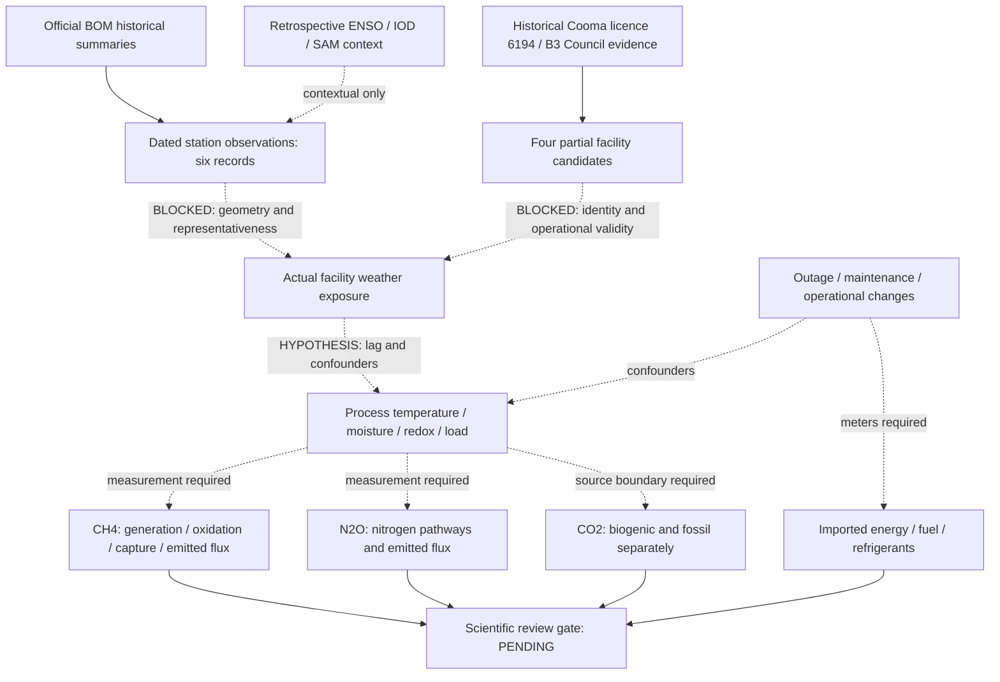

# Climate–facility–greenhouse-gas evidence map

Solid source relationships identify evidence lineage. Dashed arrows are proposed research questions, NOT established effects. No numerical model is attached.

No edge permits inference from an extreme-weather observation to a measured gas change. No national aggregation, ACCU accounting or spatial join. See [matrix](EVIDENCE_MATRIX.md) for machine-reviewable meaning of link states.
