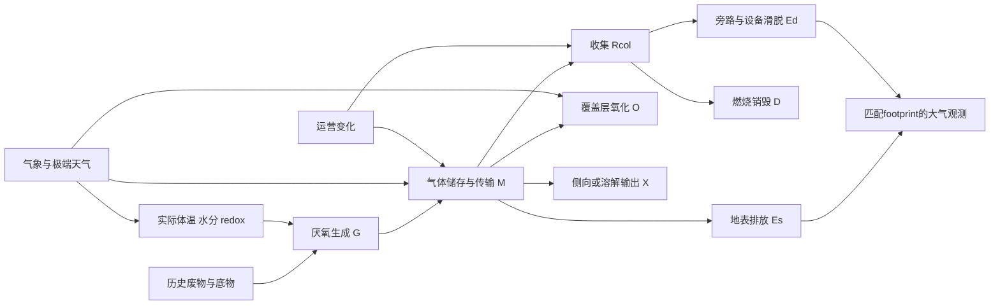

# D2 — 气候响应候选：可证伪的结构，不是已实现模型
2026-11-04 · HYPOTHESIS · 无参数赋值、无计算。
复用[P1-A模型矩阵](../p1a/METHANE_MODEL_COMPARISON_MATRIX.md)及[文献登记](../p1a/LITERATURE_EVIDENCE_REGISTER.csv)。下式为明确标注的研究模型族，不冒充法定公式或论文逐式转录。

## 机制与观测关系

箭头是研究关系，不是已证明的区域因果效应。气象影响氧化和输运，净排放可以与生成的温度响应不同方向。

## 最小嵌套候选 C0/C1
C0复现B的同一历史库存与时间约定。C1仅增加一个可辨识过程响应；不能同时自由拟合生成、氧化、收集、储存。

- 单碳库族：dS_i/dt=I_i−k_i(t)S_i；S[kgC]，I[kgC/day]，k[day⁻¹]。G=(16/12)F Σ_i k_i S_i [kgCH₄/day]。这是一种连续FOD研究表达；与年度B比时须一致处理沉积延迟与年度积分。
- k_i=k_ref,i f_T(T_body) f_w(θ)；f_T(T_ref)=f_w(θ_ref)=1。f_w形状与范围未指定，不捏造系数。
- Arrhenius族 f_T=exp[−Ea/R(1/T−1/Tref)]，T[K]，Ea[J/mol]、R[J/(mol·K)]；Q10族 f_T=Q10^((T−Tref)/10K)，Q10无量纲。两者是替代假设，不同时自由拟合；只在校准温区有效，不能越过抑制/群落转变条件。
- 氧化候选：r_ox=r_max·cCH4/(K_CH4+cCH4)·cO2/(K_O2+cO2)·f_T,ox·f_w,ox。双底物结构示意，非Lam或CALMIM原式；r_max质量/体积/时间，K与c同浓度单位。需覆盖层积分得到O。
- 传输族：∂c/∂t=∇·(D_eff∇c)−∇·(v c)−r_ox+s；c[kg/m³]，D_eff[m²/day]，v[m/day]，s[kg/m³/day]。裂隙/压力脉冲可能不服从均质1D假设；当前无边界条件，不可执行。
- 填埋体守恒：dM/dt=G−Rcol−O−Es−X。收集系统另算 dMcol/dt=Rcol−D−Ed−Xexport。整场大气CH₄=Es+Ed；外运气体、侧向迁移不能直接计为本场大气量。不要重复减“收集”和“销毁”。

## 文献证据及适用范围
| 证据 | 阅读层级与能支持的内容 | 不能支持 |
|---|---|---|
| CALMIM，USDA2011草案手册§1及输出部分；Spokas2011 DOI10.1029/2011JG001741 | 手册相关部分已读；论文搜索摘录。已有土壤微气候/氧化/传输研究框架 | 本场验证、极端事件预测能力；本轮未取得完整原式实现 |
| Spokas & Bogner2011，Limits and dynamics，USDA发表记录；原文PDF获取超时 | 搜索摘要：两个California填埋场覆盖土温湿实验 | 未核对的拟合系数与跨场直接迁移 |
| Kim2026 DOI10.5194/acp-26-7789-2026 | 原文及P1-A相关章节：FOD/CLEEN与气象优化的已有比较 | 两相邻填埋区的校准不等于独立澳洲验证；OX假设和回收混杂需审计 |
| Yvon-Durocher2014、Lam2026 | 继承P1-A阅读记录；分别温度响应与覆盖土实验模型族 | 本批未重新全读；不导入其Ea/Q10数值或称其厂级参数 |

## 可辨识性与反例
只有净排放q时，G、O、Rcol和ΔM的变化可相互补偿。必须用独立收集流量/组分、销毁运行、覆盖层剖面及实际体温/水分限制自由度。若缺失，只允许“净排放关联模型”的命名，不可声称识别产甲烷机制。
空气T是代理，需体温映射及误差；纬度/海拔只是背景，不直接给k。降雨≠入渗≠填埋体含水率。时滞须由过程和采样支持，不能沿用C2的7/30天作为物理定律。
干湿反转、设备停机、压力释放、氧化增强是C必须允许失败的反例。N₂O、化石/生物源CO₂与能源仅保留独立测量路径，不从CH₄拟合得到其排放。
