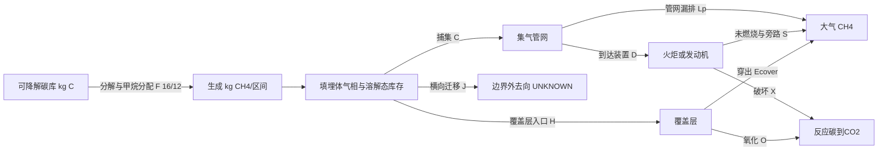

# 生成—储存—捕集—氧化—排放：同一边界的两套账

本文件是研究者推导的守恒合同；IPCC G01–G04提供年度生成/库存关系，NGER B02体现地上漏排不可当近表面氧化，ACCU C02说明送入装置不等于毁灭。不是法定公式的改写。

在全系统边界内，捕集不是排放减少本身，也不是甲烷消失。气/液相交换为内部转移；不在总CH4账中增减两次。若只量气相，必须另记溶解储量和溶解态流出，否则不能闭合。

## 定义及逐层闭合

所有量是同一指定区间内的kgCH4（不是kg/h）。M0/M1为填埋体总CH4期初/末库存，包含孔隙及溶解态；ΔMp为管网新增储量。本小工具只覆盖ΔMp≥0的三例，负储量变化不是物理不可能，而是未实现的扩展域，不能误写为通用规律。

1. 填埋体：M0+G+I=M1+C+H+J。
2. 管网：C=D+Lp+ΔMp。管网期初库存取0是三例显式假设，实际需Mpipe0/Mpipe1。
3. 装置：D=X+S。S合并设备甲烷滑漏与已知旁路，无装置内净储量的假设；未知旁路不能填0。
4. 覆盖层：H=O+Ecover。无覆盖层额外净储量的假设；若存在须移入库存或单列。
5. 全系统：M0+G+I=M1+ΔMp+(Ecover+Lp+S)+(O+X)+J。

Eair=Ecover+Lp+S；Rreaction=O+X。J是流出外边界，不等于消除；J后续进入大气与否仍UNKNOWN。代码没有泛化“其他损失”来掩盖不平衡，任何其他去向必须在新授权扩展合同后明确。

## 碳账与分子质量账

采用声明过的整数化学计量约定CH4:C:CO2=16:12:44（不是P1精细摩尔质量表）。反应消耗m kgCH4产生CO2=m×44/16 kg，其中碳m×12/16 kg。碳输入=(M0+G+I)12/16；碳输出/库存=(M1+ΔMp+Eair+J)12/16+(O+X)44/16×12/44。

CH4+2O2→CO2+2H2O说明CO2质量大于被消耗CH4并非违反总质量守恒：额外氧来自空气。本程序核对CH4物种账和碳元素账，没有把大气O2/H2O做完整全元素反应器。生物降解产生的直接CO2不由这条CH4后续反应账反推；废物碳总账还需其他碳产物、残留碳、渗滤液碳及生物量。

## 来源、参数和不确定性

FOD的DDOC是可分解碳库，不是已生成的甲烷储量；G到M0/M1的桥接需生成时窗和组分。对实际账每项都要有仪器/模型来源、单位、时窗、检出限、校准、空间代表性和协方差。未测项不是0。统计不确定性设计：r=M0+G+I−M1−ΔMp−Eair−Rreaction−J，Var(r)=aᵀΣa；共享流量计/组分仪误差不可当独立。残差接近0可能只因重复使用同一估计，不自动构成独立验证。

本轮三例输入是精确算术fixture，误差仅浮点舍入，**没有实测误差分布、置信区间或概率校准**。研究者应优先补接口观测，再决定模型复杂度。
