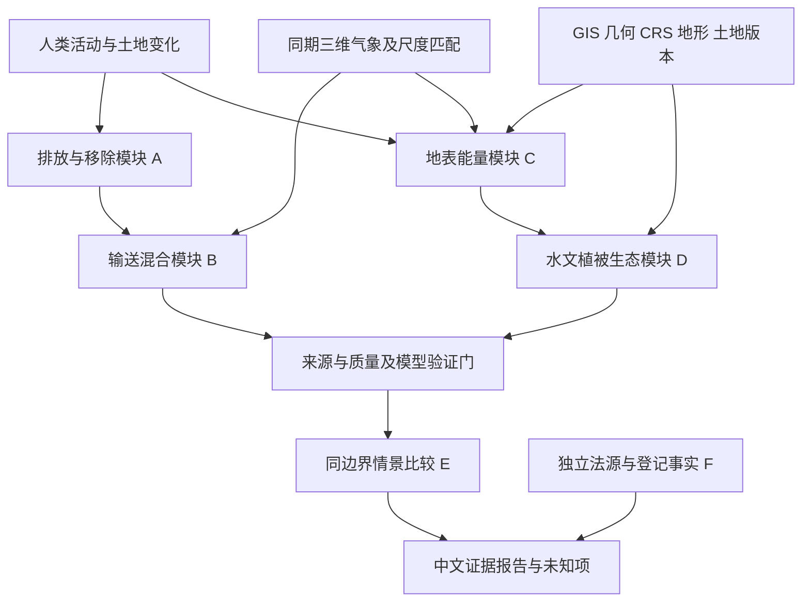

# 六个科学/制度模块及依赖

本表是问题拆分与未来准入条件，不是六个已建模型。概念式 `Y=F(A,L,M,E,t;theta)` 仅是输入输出占位：活动、土地、气象、生态与时间如何影响结果必须分别指定过程与验证，不能把它当统一环境价值公式。

|模块|问题、方法及单位|尺度、输入与假设|验证/不确定性/本轮拒绝条件|
|---|---|---|---|
|A 排放/移除|清单活动量×适用排放因子；或质量守恒估源；kg CH4/time、t CO2/time|设施/地块至区域；活动量、气体组分、校准、背景、同步气象；边界明确|排放因子适用性、独立源量/仪器校准；无D3原数据即拒绝；ppm不是kg/s|
|B 输送/混合|选择平流扩散/粒子等模型；输出浓度/足迹，不输出辐射强迫|秒分钟至小时、米至公里；三维风、稳定度、地形、源和背景；质量边界一致|留出站点/已知释放验证、风向/混合高度误差；日均风速或单点不足以反演|
|C 地表能量|辐射、感热、潜热和储热收支；W/m²、K或°C|地块/街区、昼夜；辐射、土壤水、植被、建筑和湍流|温度与通量观测校准；缺材料参数/水分/辐射不量化土地改变升温；不将热岛归因当地甲烷|
|D 水文/植被/生态|各自水量收支、植被状态、物种/群落调查；mm、m³/s、调查指数|集水区/样方至区域，事件至年；DEM、降雨、ET、土壤、管理、实地PCT/物种|独立流量/水分/重复生态调查；地图与VI都不是法定信用，保护改善有时滞和扰动|
|E 情景比较|同边界、同气象、同模型的反事实差及敏感性；保留原单位|固定区域和时窗；基准/干预、外部驱动、参数域|因果识别与模型误差需独立评估；两地/两天气差不等于开发效应；本轮全部拒绝|
|F 法律/市场|先识别司法区、现行版本、许可/信用类别/登记；不能用统一公式转换|项目与协议有效期；法源、获准评估、登记与交易事实|法律审查与数据有效期独立；价格不是生态成效；本轮NOT_ASSESSED|

这些方法名只是适用研究家族；本轮没有采用、校准或验证具体物理求解器，没有新增排放因子或信用公式。未来选择的每个求解器须附原论文/官方技术文件及可复核校准证据；不允许按这张表直接产生数值。

图中箭头为研究依赖，不是已执行耦合。实际通过的只有“公开站点字节→QA→描述统计→报告”。GIS继续使用既有一个QGIS项目多图层，不复制界面；几何一致不能替代风场高度和时间一致。地表变化影响局地热环境与全球温室气体辐射作用属于不同过程，不能把二者相加成未经定义的ClimateOS分数。

内部Evidence Object最小关系为：Source→RawArtifact→Observation（geometry/time/variable/unit/QA）→MethodRun（version/assumptions/domain）→Claim（allowed scope/uncertainty）→Report；LegalEvidence另连Claim，Transaction另连登记事实。保留各自时间、版本和父哈希。法定BAM、ACCU及AWTM资格不由本接口认定，跨制度不互换单位。
