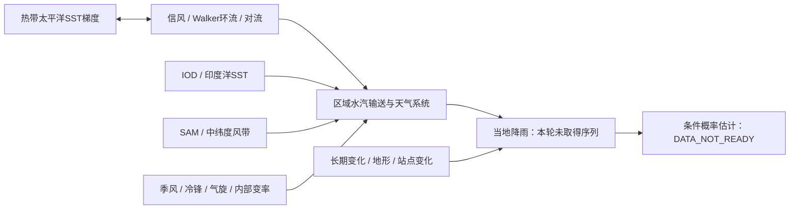

# 物理机制、混杂和尚未计算的环节

图是有来源的定性过程关系，不含已测传输系数，也不能从箭头推出唯一因果。PR146 Atlas的ENSO路径、PR147 trace原样复用；没有新增全球GIS或大气模型。

官方依据为 [BoM ENSO历史解释](https://www.bom.gov.au/climate/history/enso/) 和 [2023年度声明的Australian climate influences / Southern Hemisphere mid-latitudes](https://www.bom.gov.au/climate/current/annual/aus/2023/)。前者支持海气耦合而非SST单独充分条件；后者表明2023晚期东部转湿发生在多模态共同背景，冷锋/气旋等天气尺度过程可使季节平均关系失效。二者均不提供本轮地区的数值系数。

| 混杂候选 | 明确产品、时空/单位 | 计划检查 | 当前结论 |
|---|---|---|---|
| IOD | NOAA PSL DMI、HadISST1.1，月°C；西50–70E/10S–10N减东90–110E/10S–0；源气候态基年UNKNOWN | 雨量同季均值<0/≥0分层；不是BoM持续阈值事件定义 | 文档/网页预览可读，未取得本地原字节；无配对响应，不计算 |
| SAM相关代理 | CPC AAO，1979起月指数；700hPa高度EOF投影；元数据说明标准化参考1979–2000 | 仅1979–2020重叠，按雨量季节符号分层；不回填1961–1978 | 不冒充Marshall站压SAM；未准入/未分层 |
| 季风/MJO、冷锋、气旋 | 官方机制材料，未选定同步数值指标 | 记录未控制；最多3指数预算，本轮预登记只2个 | UNCONTROLLED |
| 气候趋势/地形/站点历史 | 后30年/基准敏感性，站点位置及源变化 | 真实序列到位后才能检查 | 未控制，因果不可识别 |

IOD与ENSO也可能共同变化；分层既可能减少混杂，也会大幅缩小样本。SAM符号的降雨意义因季节和区域而异，不能用统一“正=湿”规则。变量之间可能是共同因、通路或反馈，简单控制也不保证因果解释；下一轮若提出因果量，应先独立审查因果图和识别假设。

科学语义：**观察**＝库存与HTTP收据；**假设**＝预定条件关联可估；**解释**＝官方海气机制；**预测**＝本轮没有；**建议**＝先解锁同边界雨量证据。没有温度数据，异常高温NOT_ASSESSED；不从RONI推定当地温度或CH4变化。
