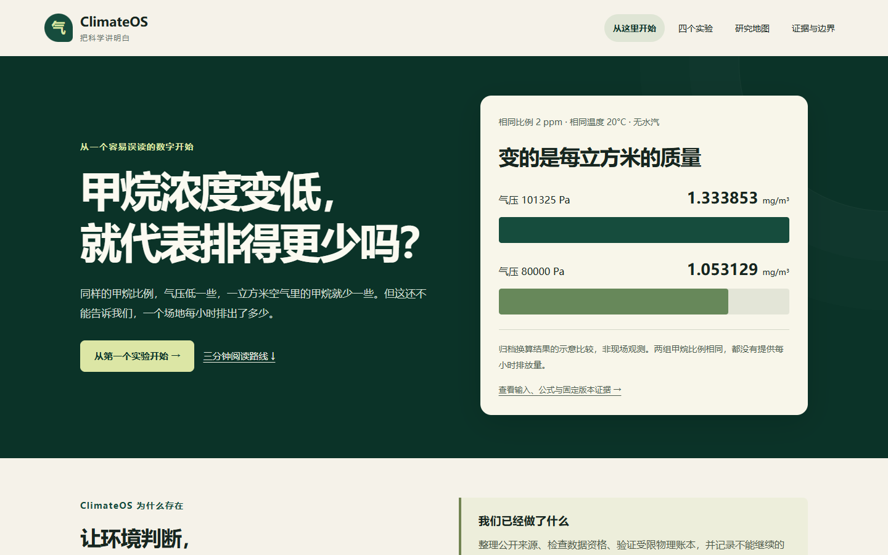

# Founder 中文验收报告

`CLIMATEOS-EXPLAINABLE-SCIENCE-WEB-001` · 2026-11-26 · **作者交付完成，等待 Founder 评审**

已把既有研究制作成中文网站阅读体验，放在主线已有 `cczps_lite/dashboard/science/`。先讲清甲烷比例、浓度与排放，再展开 #138 四个受限实验；环境场耦合、气象水文、CarbonOS/AWT、Cooma 和建筑能源韧性使用同一阅读与证据结构。**未新增科学计算，未改变科学准入，未合并、未部署。**

## 1. 看哪里

- [本机预览步骤](PREVIEW.md)：无需登录或构建；启动本机静态服务后打开中文入口。
- [研究与固定版本映射](SOURCE_MAP.md)：29项远程研究、4个实验、1条本地能源研究例外。
- [开工核查与复用决定](ARCHITECTURE_AUDIT.md)：现有网站、研究索引、未合并模块及 CI 边界。

首页直接回答“甲烷浓度变低，就代表排得更少吗？”。图形比较的是原归档换算值，标明合成输入及非现场观测。页面按钮切换文字、路由、折叠层和既有情景，不执行模型。

## 2. 开工与交付前真实状态

最新远程 main 为 `9eb7577e145e76161f9f1cd8509348b19c2904cc`，交付前再次读取未漂移。隔离分支为 `codex/climateos-explainable-science-web-001-20261126`；保留原工作副本的既有未提交内容。

逐项核对 #125、#127、#129、#130、#132、#135–#149、#152、#153、#155、#157、#161、#163、#165、#168、#169，共29项，全部开放、Draft、未合并。精确 HEAD 与源说明见 [初始快照](REMOTE_PR_SNAPSHOT.json)，交付前复核见 [REMOTE_RECHECK.json](REMOTE_RECHECK.json)。

阅读了现有站点、相关研究索引、交接/限制文件与公开评审记录。不是把所有旧测试重新执行，也不声称逐行审阅了全部科学代码。#138 额外核对了原输入、公式实现、四组结果与对照。#153 使用公开比较摘要；#130 保持元数据与受限材料边界。

## 3. 交付覆盖

| 内容 | 交付与边界 |
| --- | --- |
| 中文首页 | ClimateOS 的目的、已经做过的工作、没有证明的事、三分钟路线、研究关系与下一道门 |
| 甲烷 #137–#145 | 每项都有问题、动机、方法、数据类型、结果、尚未证明、状态、下一道验证门和固定版本证据 |
| #138 P1–P4 | 独立阅读页；生活类比、完整主要假设、参数与单位、公式、数值方法、对照、输入/输出/代码/测试/复核方法 |
| 气象、水文与耦合 | 区分全球、季节、局地与合成网络；保留 #148 历史停止、#149 后续受限描述和不确定性 |
| CarbonOS/AWT | D3、P1-A 原闸门；四情景固定结果切换；把物理账、法律基线、数据权利与信用判断分开 |
| Cooma | 设施位置与水文资料不推成污染归因；#169 拓扑冲突仍阻断所有计算 |
| 建筑能源韧性 | 只展示本地索引 v0.3 的受限摘要；标 `NOT_FOUND_REMOTE`，保留“证据不足，无法判定”；Batlow 仅场地/业主意愿/责任人待确认 |
| 证据索引 | 29项研究可按关键词与路线筛选；固定 SHA 文件链接，公开回执另列；索引分类不是审批 |

网页是43条路由的原生 HTML/CSS/JavaScript 增量，复用原静态站样式变量。没有新平台、数据库、代理、求解器、登录或第三方前端依赖。网页的唯一解释源与生成适配器约定见本任务 [README](README.md)。

## 4. 四个实验的关键信息

| 实验 | 为什么研究 | 原归档结果摘录 | 仍未证明 |
| --- | --- | --- | --- |
| P1 气体换算 | 避免把空气密度改变误读成排放变化 | 同2 ppm、20°C、无水汽：101325 Pa → 1.333853 mg/m³；80000 Pa → 1.053129 mg/m³ | 没有现场排放或海拔减排结论 |
| P2 容器阀门 | 分开产生量与库存释放量 | 24小时降压/恒压/升压累计逸出0.037632 / 0.024000 / 0.010368 kg | 纯甲烷刚性容器不是实际填埋场，释放增量不代表产气增量 |
| P3 年度库存 | 逐年追踪碳与甲烷去向 | 12年累计产生1.183144192 Gg甲烷，逸出0.638897864 Gg | 合成输入不是官方参考算例或真实设施核算 |
| P4 假设响应 | 检查扩展模型是否退回基线并保持守恒 | 基线/温度单因素/水分单因素累计逸出0.638897864 / 0.662229328 / 0.670311180 Gg；中性差0 | 未校准，不证明响应适用于现场或最终总潜力增加 |

直接输入、归档输出与原研究版本见 [四实验源映射](SOURCE_MAP.md#四个实验的直接证据)。17项显示数字/空值逐个比对已有 JSON 和舍入口径，未运行原模型；包括 AWT 的 A=0、B/C=469.353312、D=null。AWT 原公式另扣边界外5吨残渣运输；网页没有漏掉或重复扣减该项。

## 5. 实际测试，不以计划代替结果

| 检查 | 本地实际结果 | 证据 / 范围 |
| --- | --- | --- |
| 展示与来源约束 | 11/11 通过 | [本地测试记录](evidence/local-checks.txt)：完整字段、29项来源、固定 SHA、一致性、停止条件、无网络/模型调用、CI 隔离等 |
| 归档数字转录 | 17/17 通过；模型运行0次 | [数值来源核查](evidence/archived-value-audit.json)：文件 SHA256、JSON 指针、原值与展示舍入 |
| 固定源文件 | 54/54 Git 对象路径存在 | `build_sources.py --verify-git --check`；不是猜测文件名或动态分支链接 |
| 实际 Chrome | 157.0.8103.51 | [完整浏览器记录](evidence/browser-qa.json)，保存 LF 规范化页面资产 SHA256，便于跨 Windows / Git 核对 |
| 桌面 | 1440×900，43条路线 | 折叠/展开、导航、来源筛选、情景切换与键盘 |
| 手机触控模拟 | 390×844，43条路线 | 同上；实际 Chrome 移动视口与触控模拟，非实体手机 |
| 窄屏 | 320×740，43条路线 | 同上；没有水平溢出 |
| 放大与可访问操作 | 桌面200%缩放、键盘 Enter 展开、跳至正文、焦点转移通过 | 额外防止旧样式把科学变量 g、s 自动变成大写 |
| 页面错误与请求 | JS控制台错误0、页面异常0、HTTP错误0、意外外网请求0 | 页面只请求六个本地资产；证据链接点击被本地拦截核对目标，未向外发送 |
| 来源链接 | 点击打开新标签的目标与固定文件一致 | 所有固定 GitHub 文件对应已核查 Git 对象；未宣称外部站点未来永不失效 |

三类阅读验收实际走查：

1. **普通读者代理**：从首页主按钮进入 P1，能找到比例、浓度、排放三种量和“没有测量现场排放”的限制。
2. **Founder 代理**：从四实验入口找到四个研究动机与受限结论。
3. **研究者代理**：键盘展开科学层，可找到方程、单位、固定输入、显式欧拉/年度指数方法、对照、原代码/测试及复算说明。

这些是作者的任务走查，**不是已完成的外部读者理解度实验**。未测试实体手机、Safari 或屏幕阅读器完整兼容性；没有据此声称所有浏览器均通过。

截图：

- [桌面首页](evidence/desktop-home.png) / [手机整页](evidence/mobile-home.png)
- [四实验路线](evidence/desktop-four-experiments.png) / [证据索引](evidence/desktop-evidence-index.png)
- [桌面科学细节](evidence/desktop-science-details.png) / [手机科学细节](evidence/mobile-science-details.png)
- [手机 AWT 空值情景](evidence/mobile-awt.png) / [桌面200%缩放](evidence/desktop-200-percent-zoom.png)

## 6. 本地检查与远程 CI 分开

以上均为本机实际结果。初次提交本报告时尚未产生该提交的远程 CI 结果，不能将本地通过冒充 GitHub CI 通过。推送后的精确 HEAD、Draft PR 和对应 Checks 将由交付回执单独记录；本报告后续补录回执时会注明受检提交，避免自指 SHA。

CI 只读分类会保留原核心变更/手动触发的测试行为，展示站改动走独立检查；本次不触发原场景生成。已有 Pages 部署流程未运行。

## 7. 保留的科学停止状态

- CarbonOS：D3 `DATA_NOT_READY / NO_DATASET_ADMITTED`，P1-A `PENDING`。
- #140：`NO_VALID_PAIR`；#141：`NO_VALID_VERTICAL_PROFILE`。
- #138：合成/参考验证；现场与独立科学准入仍待评审。
- #163：`SYNTHETIC / SCIENCE_PENDING / REAL_DATA_NOT_READY / CREDIT_NOT_DETERMINED`。
- #165：`NO_SUITABLE_DATASET`；接受有界停止不是批准数据或计算。
- #169：`TOPOLOGY_UNVERIFIED / SCIENCE=PENDING / REAL_DATA=DATA_NOT_READY / ALL_CALCULATIONS_NO_GO`。
- 建筑能源：`NOT_FOUND_REMOTE / INCONCLUSIVE / REVIEW_PENDING / DATA_NOT_READY`，不确认节费与停电保供效果。

## 8. 交付后的待审批事项

请 Founder 评审中文表达、三分钟阅读路径、四实验科学边界和来源组织。建议之后安排一次独立非专业读者复述与科学文字审阅；它们尚未因本报告而获准执行。

研究分支收敛、数据许可补证、原始数据获取、真实计算、对外联系和现场试点继续按各自准入另批。此 PR 维持 Draft，禁止合并部署；现有 main 部署触发条件也须在任何未来合并前另审。

交付与后续记录：[CRP](CRP.md)、[NEXT_SESSION](NEXT_SESSION.md)。没有创建或修改任何自动监测任务。
