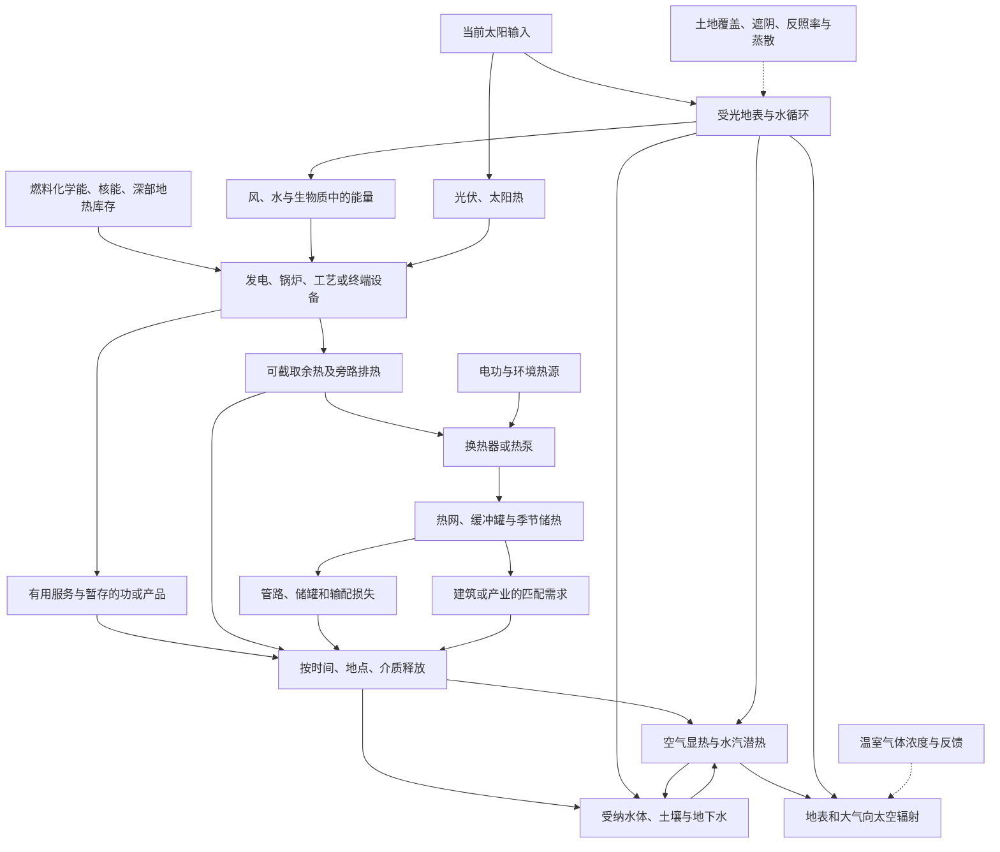

# HEAT–001｜热从哪里来，到哪里去，怎样推翻收益假设

[量纲与地球能量边界](HEAT_001_P0_DIMENSIONAL_AUDIT.md) · [准入与审批](HEAT_001_P0_SIMULATION_GATE.md)

## 同一份热的路径

箭头表示能量转移，虚线表示过程影响。节点间转移在相邻账本中一出一入。“释放”记录首次进入受纳介质的位置，热还会继续迁移。建筑需求节点包括供暖、生活热水和工业工艺热；供冷服务另记室内移出的热和室外放出的热。

图中环境热源来自既有空气、水或土壤时，在源端同步记取热。用地改变反照率会改变吸收短波，蒸发则在当地消耗能量并增湿，水汽输送和凝结会在别处释热。纯移热、替代燃料和辐射变化可同时发生，须分别辨识。[IPCC 第 7 章](https://www.ipcc.ch/report/ar6/wg1/chapter/chapter-7/) · [局地温度响应](https://doi.org/10.1029/2024GL114400)

## 每条边如何入账

选定同一服务、起止时刻、时区、区域边界及反事实。每条边记录唯一编号、源/去向、位置/高度/介质、温度与流量、时间区间、能量载体、来源/许可、不确定度与相关性。功率用 W 或 kW；区间能量用 J 或 kWh。电、热、一次能源、碳排放和暴露各有量纲与加总规则。

|控制体|守恒检查与反例|
|---|---|
|设备与换热器|同一时间窗，输入 = 有用输出 + 向环境的损失 + 库存变化；包含物质携带的焓及净功。热泵近稳态 Q热端 = Q冷端 + W电；如有外部损失/蓄热，另列。COP = Q热端/W电，泵、风机或备份系统如在设备边界外，仍须在系统边界计量。制冷排到室外的热还包含从室内搬走的热。|
|热网与储存|充入 − 放出 − 损失 = 期末库存 − 期初库存。输配、充放及用热分别记边；全网汇总内部边成对抵消。期初期末储量与温度分层需一致或显式结转。管损按实际地点进入土壤/空气；排出分析期的热计期末库存或出口，不能当作永久消失。|
|热的品位与可用性|能量守恒与做功能力分列。对恒温热源，理论可用功上限为 Q(1−T₀/T源)，温度用 K 且 T源>T₀。换热温差、混合、摩擦使可用功下降；低品位热要满足高温需求可能需大量电功。用小时需求、回水温、温升、距离、季节错配及可用率约束可回收量。|
|街区、区域及生态|地表控制体的一种约定为 R净 + Q人为 = 显热 + 潜热 + 储热变化率 + 净平流/其他输出；每项用同一面积、时标和符号，地中通量若穿越底界就列输出，若土层在内就列库存。排热法与地表实测通量相加前核查是否已含 Q人为。将下风向、受水体、土壤、夜间和季节窗口纳入；对城市以外进口电的排热另列发电地。|
|等服务的生命周期|比较相同舒适度、工艺产量、供水温度和可靠性下的两套系统；记录避免的边际燃料与新增发电、管材施工、维护、制冷剂泄漏、退役、备用供热和反弹。净温室气体用 kg CO₂e/功能单位，注明折算时域、电网时段及边际/平均口径。次级热供应者与用户不能同时主张整笔替代收益。|
|行星|气候系统净增热与原本就要耗散的太阳衍生流分开；太阳热利用仍可能改变反照率和蒸散，风水能采集可改变耗散位置和时序。搬移热不直接改变地球总能量。需另查实际跨界净通量、空间反馈及长期库存。[地球边界](HEAT_001_P0_DIMENSIONAL_AUDIT.md)|

## 可证伪假设登记

共同约定：Δ 表示方案减基线。设计值、未来观测和文献估计分栏。先确定最小有意义效应、生态与公平阈值、误差和样本方案，再看结果；阈值待所选场址/专业人员确认，不把本文件视作健康或生态标准。对收益和护栏分别报告不确定区间；某一护栏失败不得由其他收益冲销。

### H1｜相同服务下，回收和储热可以同时减少一次能源与生命周期排放

- **比较。** 同一工艺产量、热服务温度/时段、舒适度与备用能力；基线为原有冷却排热与真实可能被替代的供热组合。季节性管网/储热为方案。分别比较“不建热网、提高原系统效率”和直接电热泵等可行基线，记录边际热源与供给中断。
- **终点。** Δ一次能源（MJ/单位服务），Δ生命周期 GHG（kg CO₂e/单位服务）均应 <0；同时检查服务未满足小时、旺季备份、局地热暴露与水温生态限值。供需两端热量、电表和库存须可对账。
- **支持及反证。** 实测项目证明可把低品位热升温送网；决定净值的是替代了何种供热。低温差、短利用时数、泵电、长管损、夏季无需求、低碳基线、建设排放或反弹，均可能抵消收益。[热回收计量研究](https://doi.org/10.1016/j.egyr.2021.09.038) · [热网与储热研究](https://doi.org/10.1016/j.energy.2020.119582)
- **可复查的盈亏线。** 若基线为锅炉，避免的燃料能量为实际替代的有用热 Q替代 / 锅炉效率。用相应燃料排放因子得到避免排放；只有它超过新增压缩机与输配电的时段排放、设备材料和泄漏等全寿命增量，才满足减排条件。电网侧一次能源换算另做；排放改善不能代替一次能源改善。
- **判决。** 零假设为至少一个主终点无改善或任一护栏越限。按预注册的联合区间判决；若任一 Δ 的区间整体 ≥0 或护栏明确受损，否决该方案；区间跨零则证据不足。传播温差、流量计偏差、COP、边际电力、寿命和基线选择的不确定度，保持供需/天气相关。配对同天气与产量，检查热价诱导的新增生产及对低收入用户的服务损失。

### H2｜更改排热位置或时段可以降低脆弱人群夏季暴露

- **比较。** 先固定总热量与服务，只改变释放位置/小时；另设含新增风机、泵、冷却塔用水的实际方案，便于识别转移代价。匹配热浪强度、风向、湿度、建筑形态、植被及人群活动；保留未改动的相似街区，上下风与昼夜分别布点。
- **终点。** 受体逐时 UTCI（户外热应激综合指标）超预注册阈值的度时 × 暴露人数，单位 人·°C·h；另报峰值、夜间和各脆弱群体。需要 2 m 温湿度、风和平均辐射温度等输入。整个影响域相同口径人口加权合计，每人每时段只计一次；受纳水体日最高温、超阈时长、溶氧与低流量期另列。
- **支持及反证。** Phoenix 的特定极端热期模拟显示夜间排热可加剧局部升温。改变排放高度、加湿或把热送至下风街区/枯水河段，均可使原受体改善而全域或生态负担增加。模型结构会显著改变效应大小。[Salamanca 等](https://doi.org/10.1002/2013JD021225) · [Li 等](https://doi.org/10.1029/2024MS004431) · [河流水温研究](https://pure.iiasa.ac.at/13989/1/erl_11_10_104011.pdf)
- **判决。** 预期脆弱人群暴露下降、全域不增加、所有生态与公平护栏通过。零假设为上述至少一项失败。改善区间跨零或域外下风边界覆盖不足则未决；若受体无改善有明确证据，或任何转嫁/生态越限有明确证据，则否决。传播仪器、受体活动时段、平流边界与结构误差；仅使用获准的聚合暴露资料。单站降温不能换算为避免死亡或健康收益。

### H3｜只凭移热量，不能识别全球降温

- **反事实。** 两套封闭账的净储备能输入、GHG、反照率、总吸收短波与出射长波积分相同，始末库存条件相同；仅允许内部转移变化。可观测量为各边界积分（J）、暖冷两端的库存及其总和。全域能量差应为零；局部气温可以改变，同一总热量也不能唯一确定地表平均气温。
- **零假设与检错。** 满足上述条件时，纯内部转移导致的净能量移除为零。若计算出现非零“移除”，先检查漏列远端排热、泵电或期末库存。若独立证据显示持续的净 TOA 变化、排放或净外部输入改变，便推翻“纯转移”的前提，另立可归因机制；要声称全球温度下降还需受控温度响应及不确定度。这一反例能区分“搬热”与“搬热同时改变反馈”。
- **证据与尺度。** TOA 预算和热库存支持守恒检验。云、蒸散、反照率和边际用电可能改变实际跨界通量，因此收支相同是需检验的假设。观测噪声、海洋滞后、空间加权与不同时间窗限制辨识。不得以社区数据、人体暴露改善或短期土壤储热推断全球气候获益。[地球热库存](https://doi.org/10.5194/essd-15-1675-2023) · [IPCC 第 7 章](https://www.ipcc.ch/report/ar6/wg1/chapter/chapter-7/)

三条假设均处于研究设计阶段。H1 可先检验账的正确性；H2 的环境有效性依赖场址观测；H3 的系统边界在任何阶段都适用。
