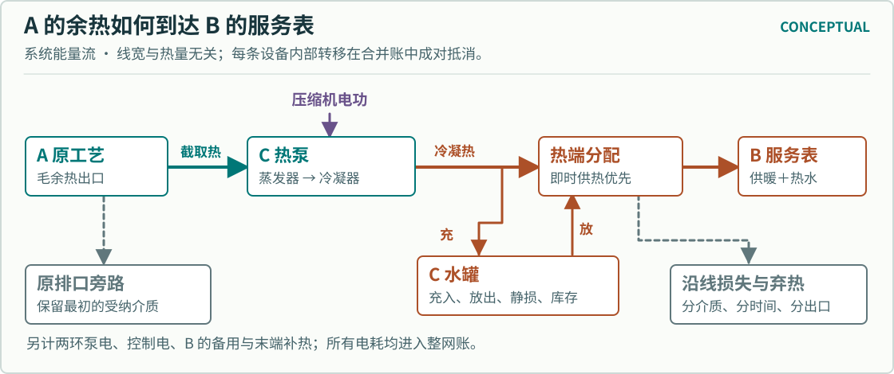
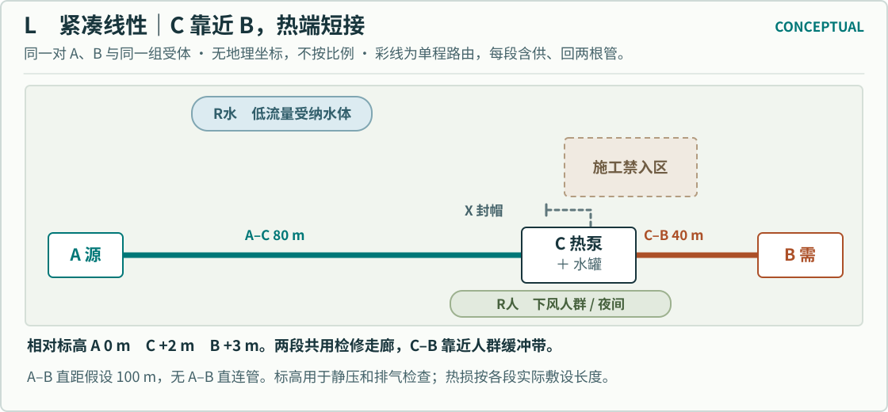
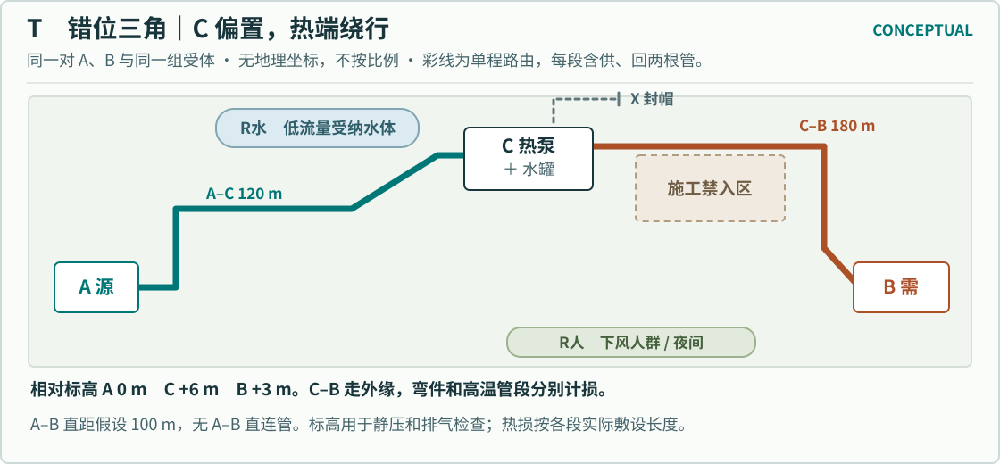
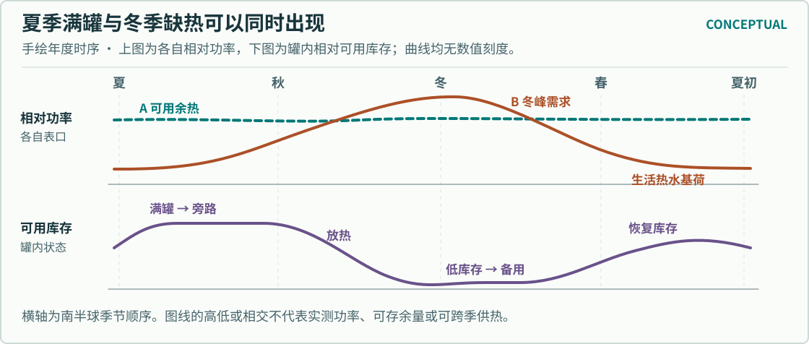
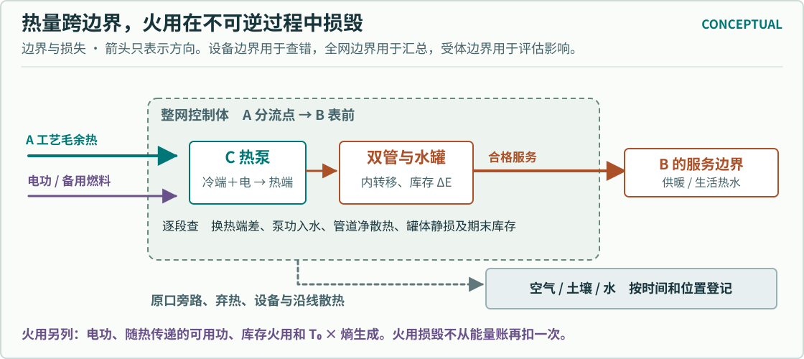

# HEAT–001｜最小热生态网络实验

**Founder 验收报告 · 2026 年 11 月 26 日 · P0-A 实验设计**

决策事项：是否允许用一份虚构热源和一份建筑服务时序，核查两种空间布局的热账。[正式任务 #175](https://github.com/simon947161/eco-agent-system/issues/175) · [上级研究 #173](https://github.com/simon947161/eco-agent-system/issues/173)

## 第 1 页｜建议批准一次受限的合成热账试算

要检验的问题很具体：在每一个需要供暖或热水的小时，把同一数量、同一温级的热送到同一建筑群，回收余热是否同时少用一次能源、少排全寿命温室气体？

**建议选 A。** 实验已给出两个可信方向相反的对照、两种走廊和可使方案失败的条件。下一步值得验证的是这些账能否闭合，以及什么条件能把收益变成负值。当前没有算例、实测节能率、减排量或受体温升结果。[实验设计](MVTEE_EXPERIMENT_DESIGN.md)

## 第 2 页｜A 有余热，B 按时要热，C 决定何时提温和储热

A 是持续运行但允许检修停供的假想工业冷却回路，100–500 kW 热、25–60 °C 是设计扰动范围。B 只有一个聚合建筑群，冬季供暖叠加全年生活热水。C 内热泵和水罐各设表口。热泵既要从 A 取热，也要用电；水罐把已获得的热留到下一时段。未能利用的热仍须登记去向。

## 第 3 页｜紧凑线性布局把提温点放在用热端附近

**看图先看 C–B。** 水被提温后只走 40 m，A–C 低温段走 80 m。热泵与水罐同置 C，冬峰放热不必重新穿过源侧长管。代价是走廊靠近夜间人群观察区，施工净距和检修停供要共同审查。封帽处 X 预留扩展，本案流量为零。[布局和管路口径](MVTEE_SPATIAL_LAYOUT_CONCEPT.md)

## 第 4 页｜错位三角布局换来了绕行空间，也拉长了高温管

A、B 与受体位置沿用上一页。C 改在侧方台地，源侧绕行 120 m，高温段沿禁入区外侧走 180 m。热走更远，增加哪些管损、泵电、施工成本，要由供回温、保温、压差和使用小时共同决定。C 侧出现另一条可能影响低流量水体的排热路径。三角形的第三边没有管线，也没有新增用户。[错位布局与受体约束](MVTEE_SPATIAL_LAYOUT_CONCEPT.md)

## 第 5 页｜比较布局时，要能说清差异来自哪一段

|配对检查|线性 L|错位 T|Founder 应查看的差值|
|---|---|---|---|
|A–C / C–B 单程敷设|80 / 40 m|120 / 180 m|分别换低温或高温段长度，检验哪段使热损或购能变号。|
|C 高程与储罐|相对 +2 m，罐后短管|相对 +6 m，罐后长管|闭环循环看摩擦/弯头压差；另验高点充水静压。只移动罐的诊断可识别罐位作用。|
|检修、扩展与受体|共用走廊，靠人群观察区|外绕障碍，较近水体观察区|空间净距、路权、设备余量和可接受受纳量尚缺。扩展端口保持封闭。|

两个网络均用相同管径系列和控制规则。把路长、弯件、介质、罐位等物理输入也全部配平后，仅改布局名称，热账应等效。任何排序都必须经得起这个空效应检查。[四因素与交互敏感性矩阵](MVTEE_SPATIAL_LAYOUT_CONCEPT.md)

## 第 6 页｜夏天取不完，冬天也可能供不上

夏季热水基荷很小，罐满后 A 须回到原口排热。冬季水罐可能在高温热水需求到来前已经见底。实验逐小时匹配两类服务，分别与既有锅炉 R0、就地热泵 R1 比较。为补足缺口或恢复期末库存消耗的电和燃料，都要计入。图是手绘假设，未推算可跨季的热量。[等服务对照与调度顺序](MVTEE_EXPERIMENT_DESIGN.md)

## 第 7 页｜五本账回答五个不同的问题

|账本|评阅时要追问什么|
|---|---|
|能量 / 一次能源|热泵的取热和电功是否只算一次？合并全网后，服务、排热、静损和库存能否对上？外购电燃料怎样折算一次能源？|
|火用|源温与所需供温相距多远？相对于共同参考态，提温用电能否自洽，换热和混合损毁了多少可用功？|
|热损失|低温与高温供回管各向何处放热？泵电及罐损落在哪个边界？|
|经济|同寿命、同服务的每 MWh 热成本和成本现值怎样变化？若 A 退出，谁承担闲置管线与备用？|
|碳|真正少用的是哪台设备？购电、备用、材料施工、泄漏及更换是否使全寿命差额翻转？|

能量守恒只说明账记对了。是否节能减排还取决于被替代的设备和全部新增投入。[五本账的公式与单位](MVTEE_BOUNDARY_AND_LEDGERS.md)

## 第 8 页｜最大的科学风险是误判被替代的热，再漏掉新增电耗

源端有余热，不保证 B 需要它的那个小时也有足够温级。低源温、长热端管线、冬季空罐可同时增加压缩机、泵和备用耗能。如果 B 原本用高效就地热泵，联网可在同样服务下反而多用一次能源或增加全寿命排放。**这个反例必须留下。**

第二条独立红线是负担转移。即使能源账改善，下风人群或枯水期下游受体变热，仍可否决环境可接受性。缺实测只能登记未决。上级审计已经指出，用全球排热功率除以大气储热率无法归因；本实验追踪热去了哪里，不能据此推导全球降温。[反证与判决](MVTEE_FAILURE_MODES.md) · [上级量纲审计](HEAT_001_P0_DIMENSIONAL_AUDIT.md)

## 第 9 页｜Founder 的审批应止于离线合成会计

|选项|范围与交回条件|
|---|---|
|**A · 建议批准 P1 合成数据受限试算**|Founder 明确授权并在见到输出前冻结参数、服务与容限。只用作者自建合成输入，交回 R0/R1/L/T 配对账、各控制体残差、空效应、负库存/双计拒收、变号反例及可重放记录。碳仅作假定因子下的账本演示。P1 完成即停审。|
|B · 要求补充证据|若暂不能决定功能单位、一次能源口径、源热归属或容限，请先核定争议项；补证范围和权利逐项登记。|
|C · 暂缓|保留设计和反证矩阵，由独立热工或环境评阅人先检查账目与受体边界。|

**当前状态为 P0 设计待验收、P1 待 Founder 明确批准、真实资料 DATA_NOT_READY、P2 NO-GO，独立科学评阅待完成。** 后续真实场址须单独通过数据使用权、伦理、访问与现场验证审查。此次没有运行数值模拟，也没有部署或接入场地。[上级准入门槛](HEAT_001_P0_SIMULATION_GATE.md)

## 第 10 页｜研究索引与 CRP 交接

|交接字段|本次冻结的内容|
|---|---|
|知识|功率、区间能量、库存、热品位及受体暴露分别计量；全球热库存份额不能给出场址收益。|
|想法|改变 C 的位置和各温级管线长度，以等长空效应、换段与只移罐对照识别作用。|
|愿景|同一份建筑服务下，让节能、碳与受体保护都能被独立核查。|
|推理|先守恒与等服务，再用合理的分离系统作反事实，再审双主终点与护栏。|
|决定|五份文档与四类五幅可编辑 SVG 进入父研究索引，建议 A，等待单独授权。|
|未解问题|实际可取温级、冬峰备用、源热归属、管沟路权、时变电力因子、受体阈值与观测均待证。|
|下一步|Founder 记录 A/B/C；若选 A，先签定合成输入与判决门槛，P1 交回正反例、停止记录及独立重放入口。|
|关键词|HEAT–001、MVTEE、热泵、储热、火用、热网、空间拓扑、反事实、守恒、碳边界、可证伪。|

[上级研究索引](HEAT_001_P0_FOUNDER_REVIEW_CN.md) · [实验与版本化来源](MVTEE_EXPERIMENT_DESIGN.md) · [两种空间布局](MVTEE_SPATIAL_LAYOUT_CONCEPT.md) · [五项账本](MVTEE_BOUNDARY_AND_LEDGERS.md) · [失败模式](MVTEE_FAILURE_MODES.md)
