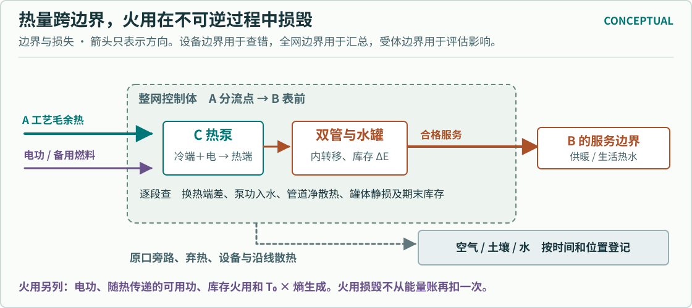

# MVTEE 的五项账本｜从热泵表口到同等服务的全寿命比较

**符号约定。** t 为同一 UTC 小时间隔，Δt 以 h 计。P 为平均功率（kW），Q、W、F 分别为区间热、电功与燃料低位热值能量（kWh）；E 为状态量（kWh）。所有转移沿命名箭头为正，差值 ΔX = X干预 − X基线。各账用自己的单位。排热进入受纳介质时，以同一流 ID 标记去向，再次汇总时只计一次。[实验臂](MVTEE_EXPERIMENT_DESIGN.md) · [故障与门槛](MVTEE_FAILURE_MODES.md)

## 一｜能量与一次能源

|控制体 / 表口|拟核的区间恒等式|定义与残差检查|
|---|---|---|
|A 原冷却回路，取点在 A 出口|Q毛 = Q截取 + Q原口旁路|固定工艺产量，先排除其他既有用途；若另有热用户，作为独立反事实处理。A–C 到蒸发器之前有低温管路交换。不能同时把毛热、截取热和蒸发热当三项总输入。|
|C 热泵制冷剂循环，含压缩机|Q蒸 + W压 = Q冷凝 + Q壳损 + ΔE机；近稳态绝热外壳时 Q冷凝 = Q蒸 + W压|COP热 = Q冷凝 / W压；只在开机且分母为正时定义。蒸发器侧水流量及温降、冷凝器侧流量及温升分别计量；供回泵和控制器均在此设备边界外。|
|C 水罐，表在进/出水口|E末 − E初 = Q充 − Q放 − Q罐损|E 用一致焓参考。温层低于服务所需温度时仍有热量，但该部分不可直接供该服务。记录温层、充放率与容量边界。若另设充放效率，其未交付部分必须赋去向，不能与同一罐损重复。|
|全网，从 A 毛热出口到 B 服务表，含 C 和 B 备用/末端|Q毛 + W全 + F备 = Q合格服务 + Q原口旁路 + Q其余出界 + ΔE全|W全含压缩机、两环泵、控制、备用/补热及边界内冷却用电；F备按低位热值。Q其余出界分列两段管损、罐损、壳损、主动弃热、未用于服务的末端散热、锅炉排烟和电机向外耗散。ΔE全含罐、水/管材及其他边界内状态。环境向管道输入时用负的净管损；若另外获取环境热，如 R1 空气源蒸发热，则在左侧另列 Q环境输入。|
|B 表后及 R人/R水 受体|Q服务 = Q供暖合格 + Q热水合格|不达标的热另记实际去向，服务缺口另记需求量，不能把缺口作已交付。表后热随排风、围护或废水流出，供评估受体；一旦已记 Q服务，后续释放不再加到同一全网支出。|

有意取广边界使原排口在两臂都能查到。缩至截取点下游时，从总账两侧分别删去原旁路份额，余下只以 Q截取 为外来余热。泵电若向水放热，分账为 W泵入水 和 W泵外散，两者之和等于端子电功；前者会出现在水的焓升，只在全网电输入列一次。冷却辅机节电由两个完整总账相减取得。无故漏项、残差超容限、源断仍取热、凭空放热均使该算例无效。

**两段管网的对消检查。** 对任一段写 Q入 + W泵入水 − Q出 − Q管损 = ΔE段。A–C 的 Q入 为 Q截取、Q出 为 Q蒸。热端分配点满足 Q冷凝 + Q放 = Q热管入口 + Q充 + Q热端主动弃热（分配点忽略蓄热）。C–B 的 Q出 到 B 入口；加上备用设备交出的净热，扣去 B 表前损失及库存变化，得到合格服务。源端未截取的旁路与热端主动弃热登记为不同出口。温差法用 P热 = ṁ cₚ ΔT，kg/s × kJ/(kg·K) × K = kW；再乘 Δt 得区间能量。

**一次能源主终点。** 各臂 PE = Σt( W购电,t × p电,t + F购燃料,t × p燃,t + 其他新增外购载能 × 对应因子 ) + PE归属源。p 的单位为 kWh一次/kWh载能，按相同区域、时段、核算惯例及一次能源范围冻结。主情景固定 A 工艺并仅分摊因联网新增的外部投入；另用已有替代用途/诱导增产情景测试归属。共同工艺负担须成对保留或对消。主报运行一次能源及每 MWh 合格热强度；设备制造的一次能源如核入另报全寿命口径。电网转换损耗已含于因子，禁止再次累加。ΔPE 和生命周期 ΔGHG 必须分别判决。

## 二｜火用及温度边界

共同参考态选取**恒定 T₀ = 293.15 K（20 °C）的合成参考环境**，环境压力 p₀ 统一取 101.325 kPa；它与随时段变化、用于热损的空气/土壤温度分开。各臂共同更换 T₀ 作为敏感性检查。恒温边界温度 T 用 K，热量转移携带火用 B_Q = Q(1 − T₀/T)；变温换热用积分 ∫(1 − T₀/T边) dQ。对液态水流，忽略压差火用时可用 m[(h出−h入) − T₀(s出−s入)]。供暖与热水在各自交付温级求有用火用，供回水应取焓熵差或逐温积分。低于参考温度时保留方向和符号，不以负值作为可领抵扣。

热泵冷热端用有效蒸发/冷凝绝对温度 T冷、T热，含两侧换热端差。T热 > T冷 时 COP可逆 = T热/(T热−T冷)，W最小 = Q冷凝/COP可逆。实际 COP 由温升、部分负荷和边界决定；越过可逆上界、无冷源或无驱动功的运行点拒收。电功火用等于其能量。控制体 B入 − B出 − ΔB存 = B毁 = T₀ S生成 ≥ 0（各 B 用 kWh 火用，S 用 kWh/K）。逐项定位换热端差、压缩不可逆、节流、混合与摩擦。排给环境的热有其边界火用；火用损毁不作为一项热量从能量账扣除。

## 三｜沿线、储罐与受纳损失

|项目|符号设计及单位|边界与实际所需证据|
|---|---|---|
|分段管路传热|Q管 = Σ段,供回 U′ L (T水均 − T介质) Δt / 1000。U′ 为 W/(m·K)，L 为该根管实长 m，温差为 K，结果 kWh 热。|架空用空气、埋地用相应土层，分别给管径/内外径、保温厚/导热率、埋深、潮湿度。U′ 若来自耦合双管须注明定义，管间换热属内部转移，不能与向土损失重复。瞬态另计管材/水库存。|
|水力和电耗|W泵 = Δp × V̇ × Δt /(1000 η)，Δp 为 Pa，V̇ 为 m³/s，Δt 为 h，η 为泵和电机总效率；Pa·m³/s = W。|分段直管按 f(L/D)ρv²/2、弯阀按 ΣKρv²/2，加换热器压差。封闭回路循环静位差抵消，高点压力、汽蚀和充水另验。控制、待机、辅机电各自独立。|
|水罐及损失|Q罐损 = Σ层 (UA)层 (T层 − T罐房) Δt /1000，UA 用 W/K。可用显热上限可由 m cₚ ΔT/3600 给出，m 为 kg、cₚ 为 kJ/(kg·K)，结果 kWh。|容量、允许温层、保温、充放速率、补水和泄放条件在档位变化时同步更新。罐损进罐房或指定受体，若另作有用供暖须有 B 表佐证并注销原损失项。|
|旁路、弃热及受体|每条排热记录能量 kWh、温级、时钟、介质、位置类别及流量；热功率与暴露量分栏。|原出口、旁路和 C 安全泄放分别标记。空气的风向/混合与昼夜、水体上/下游水温/流量/溶氧和土壤参照点均待观测。输入热量本身不能给出受体温升。|

## 四｜经济账

按同价格年实值货币（拟用 AUD）、同寿命窗口 N 年及实折现率 r。CAPEX 分开列热泵/换热器、水罐、管沟和双管、穿越、受体保护与备用增量。运营分电量/峰需费、燃料、源热合同、维护/更新、停运和退役；残值单列。成本归属采用联合系统视角，A 向 B 收费是内部转移；另列 A、B、运营方现金流核对可签约性。

对每一臂，PV成本 = 初投 + Σ年 (运行 + 更换 + 退役 − 残值) / (1+r)^年。LCOH = PV成本 / Σ年[合格服务 MWh / (1+r)^年]，单位 AUD/MWh。另报 ΔPV = PV方案 − PV基线；避免的替代费用从两个完整账得到，无第二笔回收热收益。测试管线造价、利用小时、热价/电价差、资产寿命、折现率和停供补偿，保留管线搁浅、单一源退出、跨地役权和谁承担备用责任。所有价格、寿命与融资参数均待预登记，无项目报价。

## 五｜碳账

每臂 G运行 = Σt(W购电,t × EF电,t + F燃料,t × EF燃烧) + 制冷剂泄漏质量 × 对应 GWP。因子用 kg CO₂e/kWh，相同温室气体评价时域（拟用同版 GWP100）；按共同电力区域、小时和因子年份登记。主分析用与替代问题一致的边际电力情景，平均电力另列结构敏感性。上游燃料/电力的开采、输配与发电要么在生命周期因子中，要么单列，登记覆盖项，任何一项只计一次。

G寿命 = Σ年 G运行 + 未覆盖上游 + 管/罐/热泵/备用制造与施工 + 更换及退役 + 源工艺分摊。既有资产的沉没制造量按一致前瞻边界处理，提前报废另列。用同寿命窗口的**未折现**合格服务归一化至 kg CO₂e/MWh，同时给总量、运行与非运行分项、ΔG寿命。比较 R0/R1、源原有去向和边际电力；余热截取量不生成自动负排放，A/B 不重复申领。没有材料清单、来源许可或合理反事实，真实生命周期结论为未决。[既有科学准入记录](HEAT_001_P0_SIMULATION_GATE.md)

## 记录与复算契约

沿用 HEAT 流 ID 和 BuildingOS 证据引用。每条边登记“案例/臂、流 ID、起止表口、介质、起止时刻、值和单位、边界温度、情景版本、来源/使用权、关联误差组、质量标记、人工复核人”。同一物理边在两个子账可相邻出现，合并时对消。保留未舍入项、分项残差和期初末库存，0、停机、不适用与缺失分别编码。温度比仅用 K，温差用 K，所有季节累计先统一时间步。具体观测点、反证和不确定度处理见[失败矩阵](MVTEE_FAILURE_MODES.md)。
