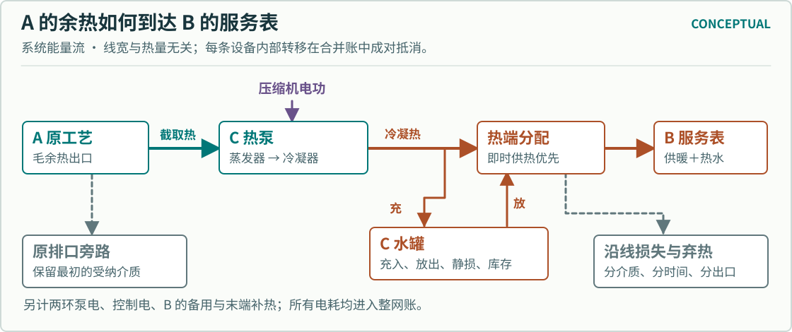
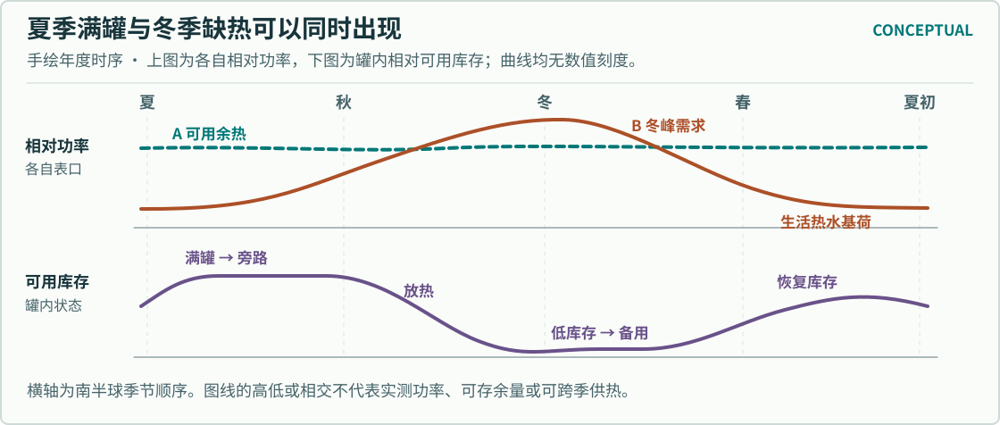

# MVTEE 实验设计｜同一份建筑热服务，换一种供热方式

**HEAT–001 · P0-A · 2026-11-26 · 设计冻结稿，待 Founder 验收。** 比较一处既有余热源与一个建筑群相连前后，为同一组住户、在同一时刻提供同样温度和数量的热，需要多少新增一次能源、造成多少生命周期排放。空间位置、时段和受纳介质一并入账。本文定义将来可以怎样失败。当前没有算例输出。[任务 #175](https://github.com/simon947161/eco-agent-system/issues/175) · [上级 #173](https://github.com/simon947161/eco-agent-system/issues/173) · [Founder 验收](MVTEE_ACCEPTANCE_REVIEW_CN.md)

## 三个对象与计量口

|对象|拟定输入与操作|独立记录|
|---|---|---|
|A · 假想连续工业冷却水回路|工艺产量在各臂相同。用任务书给出的 **100–500 kW 热、25–60 °C 出水**作为可选择的合成工况。源的日内基荷上叠加波动、计划检修和整段停供。供热方可优先保护工艺回水温度。|记录毛排热、允许取热、实际截取和原出口旁路。可截取功率受可用时数、流量×比热×允许降温、换热端差、合同上限和设备容量共同限制。毛排热不等于可售热。保留停产、余热已另有用途、所有权变更及提前解约反例。|
|B · 单一聚合建筑服务端|冬季空间供暖叠加全年生活热水，夏季仅保留热水基荷及预注册的少量供暖。合成服务可取供暖二次环路供/回 45/35 °C、生活热水交付目标 60 °C；均为情景设定，卫生与实际设定值须另审。|同一建筑群内按两类服务分别记录时序需求、交付温级、小时缺口及可靠性。生活热水另记进水温、用水量、隔离换热和末端补热。不同用途禁止用一个平均供温掩盖不达标。|
|C · 热泵与显热水罐|A–C 为低温供回环路，C–B 为热水供回环路。压缩机取热提温。热端优先供即时需求，余量才充罐；不足先用温级合格的库存，再调用 B 的既有备用。满罐时减少截取，余热回原出口。|分别计蒸发器取热、冷凝器放热、压缩机电、两侧循环泵电及控制电。罐表记录充/放热、静损、可用温层、期初/末库存和充放功率上限。源侧与负荷侧、储热与放热各有独立边号。|

美国能源部的区域供热技术资料说明了保温管网、建筑接口和低温余热接入的一般结构。这里的容量、温度、路长和库存状态均由任务设计指定，没有引用设备实测曲线或任何场址资料。[DOE《District Energy》，pp. 1–2](https://www.energy.gov/sites/default/files/2021/03/f83/District_Energy_Fact_Sheet.pdf)

## 功能单位、系统臂与反事实

**功能单位**为 B 表后满足约定服务向量的一年有效热；同时按每 MWh 合格有用热报告强度。逐小时匹配空间供暖负荷及舒适时段、生活热水量及温级、可靠性和 A 工艺产量。固定同一非闰合成年、UTC 小时起止、相同南半球季节序列、气象驱动与用水日程。年总热相等但冬峰缺供，仍判比较无效。各臂末态回到各自初态，含罐分层、管网热容及建筑状态；若补能恢复，计入对应电、燃料和成本。

|配对臂|A 端|B 端和 C 端|辨识目的|
|---|---|---|---|
|R0 分离供热，主反事实|原工艺、原冷却与排热出口；保留冷却辅机电|B 用合成既有锅炉和辅机供暖/热水，同样安排保供与末端损耗。没有输热管及 C。|只有逐时真正少用的锅炉燃料及冷却功才可能形成差额。|
|R1 高效分离供热，替代反事实|同 R0|B 就地空气源热泵加同等末端补热，含除霜、随气温变化的效率及峰值备用。|检验当可能被替代的热本来就较低碳时，联网收益是否翻转。|
|L / T 干预，两种布局分别与 R0、R1 比|相同可用源和工艺，截取改变原冷却负荷，其余仍旁路|同规格热泵、水罐、末端、备用、调度规则及服务。只改变走廊、C 的位置和分段路长/高程。|先看每个干预相对同一基线的差，再算 T−L；第二层分别固定等路长或固定罐位，分辨机制。|

备用/补热是 B 内既有服务设备，干预、基线按实耗记账。空间设计的封闭扩展口不交换热。额外开用户、改变工艺产量、免费调用已有余热用途，均会改变反事实，需单列情景。

## 季节问题与操作顺序

图中时间从南半球夏季开始。上带可用源热和 B 端需求位于不同表口，线条只表达各自的季节形态；不能由两线的垂直差读取可存热。下带只画满罐、释放、见底与恢复的候选次序。短时水罐能否跨日或跨季，取决于有效温层、容量、静损和季初状态；年度平衡可以掩盖逐小时失败。

1. **预登记。** 锁定拓扑/时钟、R0/R1、逐项服务、备用、允许取热、起末态、共同输入版本、主终点及误差容限。记录各项 TBD 的决定人，阈值在看到任何结果前冻结。
2. **先做配对再扰动。** 拟按 R0、R1、L、T 共用一份输入。依次改变路长、温级、B 内峰值同时性、储罐容量，并加入两个联合作用及强制故障；每次保留同工况对照。[空间设计与敏感性矩阵](MVTEE_SPATIAL_LAYOUT_CONCEPT.md)
3. **逐表口验收。** 先做单位、分流、热泵、罐、闭环水路和总账残差检查，再看逐时服务、一次能源、全寿命碳、成本、排热去向。受体危害独立判断。缺项登记 UNKNOWN，保留符号反转与不能分辨的案例。[五项账本](MVTEE_BOUNDARY_AND_LEDGERS.md) · [可证伪方案](MVTEE_FAILURE_MODES.md)

## 已核实的研究入口与复用决定

主库 main 为 [9eb7577e145e76161f9f1cd8509348b19c2904cc](https://github.com/simon947161/eco-agent-system/commit/9eb7577e145e76161f9f1cd8509348b19c2904cc)。HEAT 目录及五份父文档位于未合并 [Draft #174](https://github.com/simon947161/eco-agent-system/pull/174) 的 [de0b951e5644696e956c20cc03ab848e5742be70](https://github.com/simon947161/eco-agent-system/commit/de0b951e5644696e956c20cc03ab848e5742be70)。核查两棵完整路径树、HEAT 分支和 MVTEE 的代码及 PR 检索；在此范围未发现独立 MVTEE 设计或 HEAT 专属 INDEX/NEXT_SESSION 文件。实际入口是[父报告第 8 页的研究索引](HEAT_001_P0_FOUNDER_REVIEW_CN.md)。在该入口增补本包。

|已阅来源|用于本设计|证据与权限边界|
|---|---|---|
|[HEAT 来源登记](HEAT_001_P0_SOURCE_REGISTER.md)、[量纲审计](HEAT_001_P0_DIMENSIONAL_AUDIT.md)、[H1–H3](HEAT_001_P0_THERMAL_NETWORK_HYPOTHESES.md)、[模拟准入](HEAT_001_P0_SIMULATION_GATE.md)|沿用唯一转移编号、等服务、匹配期末库存、H1 双主终点与 H2 受体护栏。|父审计发现把所有非海洋储热归给大气会混淆陆地、冰冻圈和大气。文献的约 39% 不能用作设备收益、阈值或全球增温归因，v2 全文差异仍待核。参见[原研究 §6、图 8–9](https://essd.copernicus.org/articles/15/1675/2023/)。|
|[BuildingOS M1 索引](https://github.com/simon947161/BuildingOS/blob/b0329def1a870483e8fd9b4f4de4e2413fd08fca/docs/BUILDINGOS_SPECIFICATION_INDEX.md)及[跨域证据接收契约](https://github.com/simon947161/BuildingOS/blob/b0329def1a870483e8fd9b4f4de4e2413fd08fca/docs/BUILDINGOS_CLIMATEOS_CROSS_DOMAIN_EVIDENCE_INTAKE_CONTRACT.md)|用既有证据项关联设备表口、证据来源、权利与人工评阅人。|契约没有为 B 提供温度记录、舒适度观测、建筑身份或 BMS 接入授权。|
|[Energy 主线研究](https://github.com/simon947161/eco-agent-system/blob/9eb7577e145e76161f9f1cd8509348b19c2904cc/research/australia-renewable-energy-system-interface-analysis.md)及[建筑能源韧性摘要的 energy 条目](https://github.com/simon947161/eco-agent-system/blob/055af110423a4759a88b01896e1813ede4abe50b/cczps_lite/dashboard/science/content.js)|电力情景需说明区域、时钟、峰段、平均/边际口径；保供与节费分别验收。|公开摘要不能填入逐时负荷、费率或设备可用率。|
|[EcoEngine 主线适配器](https://github.com/simon947161/eco-agent-system/blob/9eb7577e145e76161f9f1cd8509348b19c2904cc/cczps_lite/integration/ecoengine_v192b_adapter.py)及[成对对照](https://github.com/simon947161/eco-agent-system/blob/fcea1629d345596cb4094a1a6686d5e6750c2304/docs/tasks/ecoengine_v200_private_method_comparison_001/PAIRWISE_RESULT_PUBLIC_ZH.md)|复用共同输入标识及不可比记录；保留时段、单位和来源差异。|历史对照有四组输入治理可比、两组原生元数据不兼容。适配器与天气模式输出不提供现场热通量真值。|
|[CarbonOS 研究索引](https://github.com/simon947161/eco-agent-system/blob/2ec66ae41ae2e1d4a0f1aaa92aa98c9f0ff4c5b0/docs/research/carbonos/INDEX.md)及 [AWT #162 资产审计](https://github.com/simon947161/eco-agent-system/blob/9aea387a4261b913163b3be3197597089d9e9414/docs/tasks/climateos_awt_001/EXISTING_ASSETS_AND_GAPS.md)|把直接记录、反事实、主张、许可和审签拆开；缺项即停止对应判断。|只引用公开文档。历史数据准入与碳主张权限均不外传。|

**资料许可。** 本轮只查阅公开仓库和论文/机构公开页面，以版本链接引用。五张图均为本次原创概念图。未导入第三方数据、Council 资料、真实表计或坐标。P1 候选输入须逐项标明作者自建、SYNTHETIC、版本及用途；真实数据另需权利人、允许用途、保留期和独立准入。任何场址均为 DATA_NOT_READY。

## P0 文档核验记录

- 核对交付清单、父索引的五个入口和验收报告的十页顺序。六份改动 Markdown 的 60 处相对文件引用全部指向存在的文件，共 15 个不同目标；17 张表逐行列数一致。
- 四类图包括系统能量流、两张空间图、季节时序和控制体/火用。五个 SVG 均经 XML 解析并渲染为预览，逐图目视检查汉字、箭头、图例、距离和受体。检查唯一 ID、内部箭头引用、可编辑文本与路径、CONCEPTUAL 标记及报告嵌入。未使用外链位图或脚本。
- 对照公式单独核查流量温差热功率、管损、泵功、水罐库存、火用损毁、一次能源、平准化热价和碳排放八组量纲。另查热泵冷热端、期初末库存、内部边对消、六条失败路径和两项空效应/故障检错。本次检查只读取文件、解析图和核对符号单位，未代入热工情景或计算性能。
- 递交物限于五份新 Markdown、五个 SVG 和父索引的一处增补。分支指针、提交、文件差异及 Draft 状态的 GitHub 回执随 PR 归档。等待项为 Founder 决策、阈值冻结、独立科学评阅和真实数据权利。
