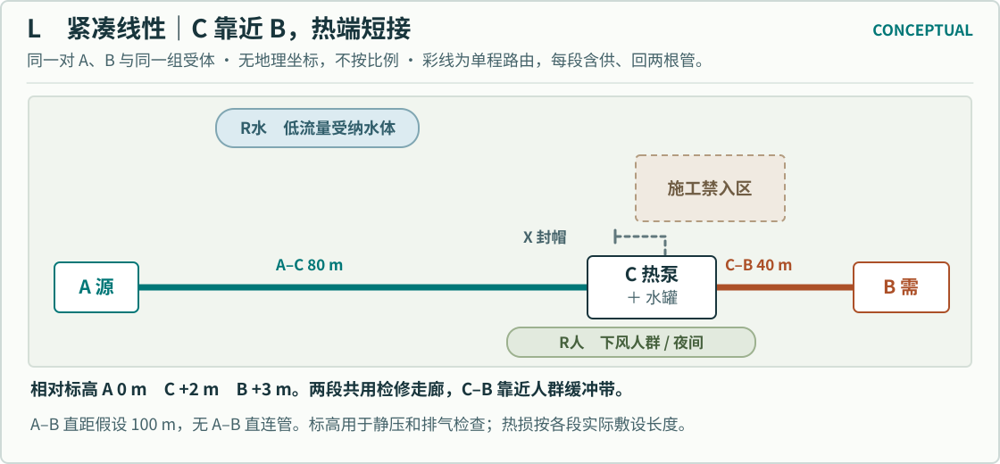
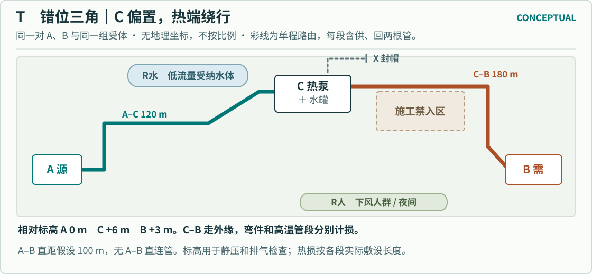

# MVTEE 空间布局｜同一源、同一服务点，改变热泵和水罐所处的走廊

**几何思想实验 · CONCEPTUAL。** 下图并列比较的对象是同一假想 A、B 及同一组受体。A 与 B 的示意直距定为 100 m，仅用于说明绕行；未采用地理坐标、实测距离或地图比例。供热网络始终只有 A–C、C–B 两条连接。三角形描述站位，没有 A–B 第三条输热管。[功能单位与对照](MVTEE_EXPERIMENT_DESIGN.md) · [Founder 验收](MVTEE_ACCEPTANCE_REVIEW_CN.md)

## L｜紧凑线性，共用既有走廊

A–C 沿低温廊道敷设，C 设在 B 侧的短热网入口。热泵和水罐同置 C，便于峰时从罐向 B 送热。既有通道可少绕行，但靠近人群活动区 R人；开挖、检修和热端泄放需留隔离带。公共走廊若封闭，两段均可能停供。A 的原排口仍面对 R水 水体观察断面。入口与缓冲距离须在任何真实设计前核实。

## T｜错位三角，绕障后进入 B

C 移至侧方可维护台地。A–C 折向台地，C–B 高温段沿外侧绕开施工禁入区再折回 B。水罐仍归 C，距 B 更远；预留扩展和检修的可能性增加。若 C 的泄放出口更接近 R水，或绕行段处在热敏土层，避开 R人 并不能保证整体风险下降。R人、R水 的身份、背景和服务时段在两臂共用，改的是路径和释放点。

## 距离、高程与沿线账目

|设计量|L 线性|T 错位三角|记账或约束|
|---|---|---|---|
|A–C 单程中心线，低温供回管|80 m|120 m|每条供、回管各沿此长度。不可用 A–B 直距计损，也不可在已含双管的线损上再乘二。|
|C–B 单程中心线，高温供回管|40 m|180 m|保温厚度、外径、导热率、埋深和土温可独立变化。另列架空、接头、阀井与潮湿保温段。|
|相对标高 zA / zC / zB|0 / +2 / +3 m|0 / +6 / +3 m|以 A 为相对高程基准，记录分段有符号高差、高点排气和充水压力。充满的闭环稳态循环不把净静扬程按两段累加；泵功由沿程、局部阻力和效率决定。|
|水罐的热边界|C 在 B 侧，罐后短热管|C 在偏置台地，罐后长热管|罐的静损取各自罐房环境温度。罐旁泄放、检修排水、冻害与二次围护均标受纳介质。|
|障碍和受体|直行邻 R人，留检修通道和受体缓冲|外绕禁入区，弯件增多，C 侧邻 R水|R人 观察下风向人群/夜间，R水 观察低流量期水温/溶氧；沿管另记土壤热输入。几何邻近只触发待查项。|
|扩展口 X|C 走廊侧封帽，施工净距可能受限|C 台地侧封帽，有潜在走廊|本实验两口均封闭、流量为零。扩展前另验源/泵/高温管余量、末端压差、罐用地、路权与受体容量；另立服务反事实。|

图中每根彩线代表一对保温供回管。按段记录 `trench_m`、`leg_id`、管材/内外径、保温及接头状况、介质、局部阻力、流量和沿线温度。热损落到所在土层/空气，停运段允许冷却；瞬态时加管水和管材库存。压力不足、漏损或开式补水单列，不能把漏水焓或坡度再计入闭环摩擦。两布局首先共用同一管径、保温系列、泵效率与温控规则。[损失与泵功公式](MVTEE_BOUNDARY_AND_LEDGERS.md)

## 敏感性矩阵｜先辨认是哪一段造成差异

下列列项都是**拟测试的输入档位**。主配对一次只变一项，R0/R1 与 L/T 共用同一负荷实例、A 可用性、备用设备和时钟。任何改变总服务的变体须重新匹配四臂。

|变因|两布局如何施加扰动|保持相同|预先查看的响应与反例|
|---|---|---|---|
|管线长度与哪一段绕行|先用图示长度；再分别只交换 A–C 或 C–B 的路长；最后把两布局均设为同一分段路长。等长组另固定弯件/介质和温度，以检查几何标签的空效应。|供回温级、同一流量控制、管径和保温等级|比较每段热损、压差、泵电、B 供温及增量资本支出。长高温段可能比同长低温段更敏感；若温差或流量关系改变，排序允许反转。|
|A 的源温|用 25 °C 与 60 °C 两个假想端点及其间预登记档；单独插入源停供窗口。|A 毛功率上限、B 温级、换热器端差与备用|看蒸发温度、所需提温、COP、电力及备用份额。工艺回水底限或最小端差可使可取热先归零。|
|B 内部需求多样性|同一群内取“供暖/热水峰同步”和“错峰”两种时序；该档的所有臂共用同一新服务序列。|每类全年用热、温级、人数、可服务时段|比较峰值及缺供小时和备用需求，判明是负荷错峰还是空间变化带来差异。|
|储罐容量及位置|零可用容量（旁通诊断）、短时缓冲、较大水罐；面积热损与充放功率随物理尺寸更新。位置对照仅把相同罐移至 B，热泵留在 C，明确新增/消失的热管边。|同一可用温差、启停规则、各臂期末恢复到各自期初|看满/空罐时长、热水温级、静损、充放峰和绕行段峰流量。大罐不会自动把夏热带到冬季。|
|联合反例|① 低源温 × 长热端管路；② 夏季低需求 × 容量/静损；再将同组置于 R1 的较低碳反事实。|同一小时输入、库存归属、费用/排放边界|查看能源、碳、成本差异是否变号，记录首先失败的护栏和窗口。|

等长、同阀件、同罐位、同介质以及同泵曲线条件下，给布局换名字应无热账差异。把储罐移到 B 的诊断使用同一只罐和同一功能单位，仍归 C 的储热功能管理。初始方案的差异同时含位置、距离和弯头，只有完成这些拆分，才能给差异归因。[否证与复核规则](MVTEE_FAILURE_MODES.md)
