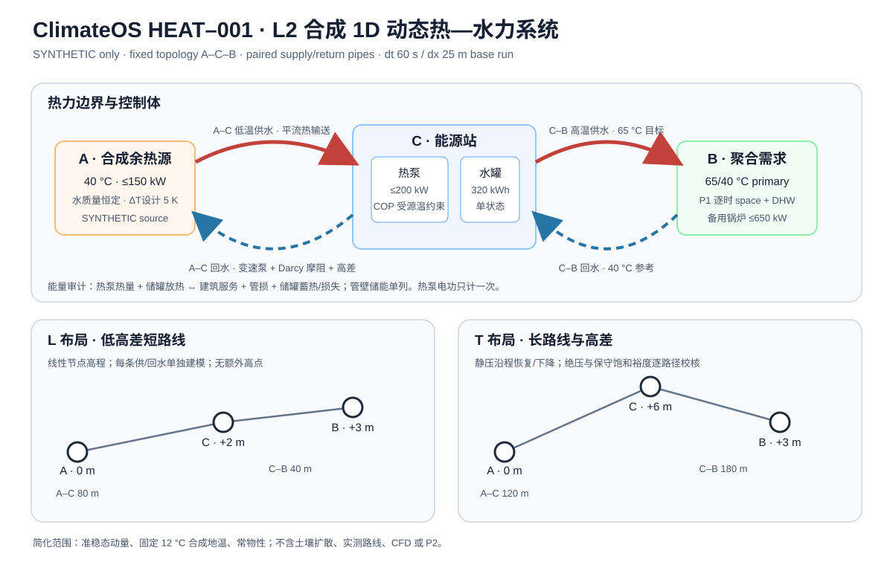

# ClimateOS HEAT–001｜Founder 科学验收简报

**L2 SYNTHETIC IMPLEMENTATION · Founder 决策版 · 2026-11-27**  
状态：**INCONCLUSIVE / 等待 Founder 科学验收** · 范围：离线、合成、1D 瞬态热—水力

---

## Slide 1｜决策摘要

### 两个中央年度案例已跑通，完整收敛矩阵因资源门停止

- 执行了 L、T 两种固定合成布局：相同 8,760 小时 P1 需求、dt=60 s、dx=25 m。
- 热网能量残差：L `5.14×10⁻⁷ kWh`；T `−4.06×10⁻⁷ kWh`。
- 罐能量残差：L `−1.71×10⁻⁷ kWh`；T `−1.56×10⁻⁷ kWh`；两布局期末库存 0。
- 独立逐时复算均还原服务总量 `909,419.86 kWh/y`。
- 完整收敛计划按实测性能外推超过 180 秒冻结预算；没有运行其余网格/步长情景。

**本次结论：不接受 L/T 科学排序；请求 Founder 选择修复证据路径。**

---

## Slide 2｜不可变研究边界

**固定设计 SHA：** `8b08152670406ec57de443facd5d589060a675b0`  
**P1 合成基线 SHA：** `5a2039a2753142b2eb17665da2dba6c4a8648b14`  
**L2 冻结合同 v1.0.1 SHA-256：** `60861f0fc5c34e14f7c66feff10b70b7680e61809cbf27e3df9225c4232a9c7b`

- A：稳定合成余热源；C：热泵与单状态可选储罐；B：单一季节聚合需求。
- L：A–C/C–B `80/40 m`，节点高程 `0/+2/+3 m`。
- T：A–C/C–B `120/180 m`，节点高程 `0/+6/+3 m`。
- 供回水分管计算；无第三条 A–B 管道。
- P1 原输入与小时夹具按 SHA 固定，不改写、不重算。

---

## Slide 3｜模型如何连起来

水力：Darcy–Weisbach + 局部损失 + 闭环高差，变速泵遵从冻结泵曲线；逐步检查绝压与饱和裕度。热力：显式有限体积迎风输送、管水与管壁独立热容、固定合成地温 U′。设备：动态源回水温决定 COP；罐状态和备用锅炉与 B 需求逐步衔接。

既有设计图采用固定 SHA 链接复用，不覆盖原稿：[P0-A 线性图](https://github.com/simon947161/eco-agent-system/blob/369ee6b9703fedb54ca4da684920e6c23825d6ca/docs/tasks/climateos_heat_001/figures/mvtee-linear.svg)、[P0-A 偏移布局](https://github.com/simon947161/eco-agent-system/blob/369ee6b9703fedb54ca4da684920e6c23825d6ca/docs/tasks/climateos_heat_001/figures/mvtee-offset.svg)、[L2 热水力图](https://github.com/simon947161/eco-agent-system/blob/8b08152670406ec57de443facd5d589060a675b0/docs/tasks/climateos_heat_001/figures/l2_thermo_hydraulic_system.svg)。

---

## Slide 4｜验证证据

- 解析/组件测试 `12/12` 通过：静水压、层流 Darcy、无损输送时间、有限热容、闭环静压抵消、零流/反向流、泵/COP/压力边界、罐状态与错误输入。
- 每个 L/T 年度案例暖机 2 个重复年度后满足逐格周期差 `0 K`（门槛 `0.01 K`）。
- 服务与 P1 配对输入相符；失供超过 650 kW 的守卫会使运行失败。
- 独立程序不导入模型：读小时 CSV 再计算服务、罐平衡与管网能量平衡，复算残差均约 `10⁻⁹ kWh`。
- P1 原 34/34 回执只引用，不在本任务重跑。

证据：[`L2_ANALYTIC_BENCHMARK_RECEIPTS.md`](L2_ANALYTIC_BENCHMARK_RECEIPTS.md) · [`L2_CONSERVATION_CONVERGENCE.md`](L2_CONSERVATION_CONVERGENCE.md)

---

## Slide 5｜中央情景结果（SYNTHETIC）

| 方案 | P1 主能耗 kWh/y | L2 主能耗 kWh/y | P1 LCOH AUD/MWh | L2 LCOH AUD/MWh |
|---|---:|---:|---:|---:|
| R0 | 1,111,513 | 参考 | 95.83 | 参考 |
| R1 | 654,155 | 参考 | 75.14 | 参考 |
| L | 429,983 | 428,789 | 74.25 | 73.22 |
| T | 447,311 | 467,199 | 90.30 | 90.87 |

粗网格 L2 的 T−L 主能耗差 `+38.41 MWh/y`，P1 为 `+17.33 MWh/y`；方向相同、幅度不同。**缺少预注册时间/空间收敛证据，不能据此判断动态水力是否稳健改变排序。**详见 [`L2_PAIRED_SPATIAL_COMPARISON.md`](L2_PAIRED_SPATIAL_COMPARISON.md)。

---

## Slide 6｜物理限制和可能的排序敏感性

- 常物性水、合成 0.2 m 内径、固定粗糙度与局部 K；泵按简化曲线运行。
- 管路只有线性节点高程，没有实测中间高点；土壤只用固定 12 °C 和继承 U′，无季节土壤热扩散。
- 热泵是冻结 Carnot 分数近似；储罐为单状态，无分层；建筑负荷聚合。
- T 方案的长管与 +6 m 高差提高管损、延迟及压力边界敏感性；粗网格看到更大 LCOH 与能耗惩罚，但未通过分辨率收敛。
- 真实 H2 受体响应仍 `UNKNOWN`；H3 全球冷却 `NOT_TESTABLE`。

---

## Slide 7｜资源门与已停止的工作

- 本机：Ryzen 5 9600X，6 核/12 线程；总 RAM 31.17 GiB，检查时可用 16.33 GiB；C 盘可用 319.20 GiB。
- Python 3.14.4 x64；仅标准库。实际 L 工作集峰值 `47,501,312 B`；L/T CSV 合计约 `4.75 MB`。
- L、T 两中央年度案例实际耗时 `15.285 / 19.910 s`。观测速度约 `1.15M` 单元更新/s。
- 冻结的最低 276.5M 更新规模按实测速度估算约 `244 s`，超过 180 s 上限；完整三层网格/步长矩阵还更大。
- 已停止后续年度模拟。未安装软件、未读真实数据、未运行 CFD/P2、未合并主分支。

---

## Slide 8｜Founder 需要决定的事项

请选择一项用于后续重新冻结与验证设计：

1. **REQUEST REPAIR / EVIDENCE：** 指定/授权更快且可核验的运行环境或增补计算时间，再完整执行冻结的 dt、dx 收敛矩阵。
2. **HOLD：** 保持本次两个粗网格案例作为探索材料，不接受排序，暂停 L2 验收。
3. 若考虑缩小收敛矩阵，需先由 Founder 审批一个有科学依据的新冻结合同；本次不自行缩小或追加精度阈值。

---

## Slide 9｜验收请求与边界

当前建议选择 **REQUEST REPAIR / EVIDENCE** 或 **HOLD**。`ACCEPT L2 SYNTHETIC` 需要完整收敛证据，本提交未达到。

本交付不授权进入 3D、P2、真实区域数据、CFD、部署或主分支合并。后续工作必须等待 Founder 对本轮证据和资源路径作出明确决定。

报告提交分支与准确 HEAD 见 Draft PR 元数据及 `L2_IMPLEMENTATION_INDEX.md`；Founder 后续审批应锚定该 HEAD。
