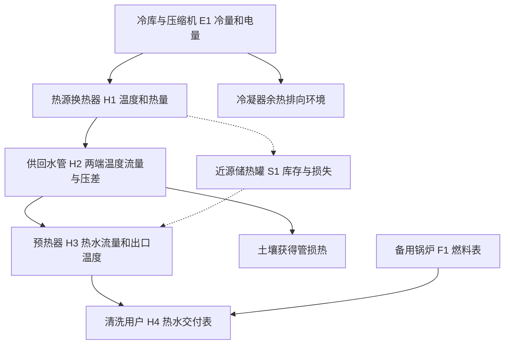

# 第二批审阅｜把同一份余热送远，什么时候该关泵？

**在第一批的冬季同班代表日，将换热使用点从就地移到单程 100 m 处，送给清洗水的热从 50.46 降至 37.37 kWh。锅炉补足差额后，两种布置均交付 8 t 产品和 3,200 kg、65°C 热水。100 m 布置相对原供能少排 8.44 kgCO₂e/日，相对就地回收多排 3.10 kgCO₂e/日。** 这是独立的合成管线路径筛查。真实距离选择还需要负荷、管径、保温、地温、流量、压差和调度记录。

[第一批审阅](https://github.com/simon947161/eco-agent-system/pull/190) · [固定输入及受控服务](https://github.com/simon947161/eco-agent-system/blob/8101d81be403ddaf45f7cbd9fe80081bf63baeb0/docs/tasks/climateos_heat_001/site_heat_cold/fixture.json) · [第二批任务](HANDOFF.md) · [复算程序](route.py) · [结果表](route.csv)

## 三个可直接使用的判断

|一程沟长 / 策略|送到热用户 kWh/日|两管损失 kWh/日|新增线路泵电 kWh/日|原锅炉补燃料 kWh/日|总购电 kWh/日|运行排放 kgCO₂e/日|相对原供能 kgCO₂e/日|
|---|---:|---:|---:|---:|---:|---:|---:|
|原供能，停回收|0|0|0|240.42|75.708|89.723|0|
|就地回收，0 m|50.464|0|0|181.05|76.314|78.182|−11.541|
|100 m，开泵|37.371|13.093|0.040|196.45|76.354|81.285|−8.438|
|467.040 m，开泵|1.855|48.609|0.188|238.24|76.501|89.723|约 0|
|479.555 m，开泵|0.920|49.544|0.193|239.34|76.506|89.946|+0.223|
|479.555 m，停回收|0|0|0|240.42|75.708|89.723|0|
|492.069 m，开泵|约 0|50.464|0.198|240.42|76.512|90.165|+0.442|

1. **现场先看就近用途。** 这组同用户、等服务条件下，增加任意正距离都会增加相对就地回收的排放；相对就地的交叉点是 0 m。不同热用户的用量或价值不同，需另配对。
2. **“还能送到热”和“值得送热”有两个边界。** 在这里对照独立供能，467.040 m 已耗尽减排收益；492.069 m 才耗尽热交付能力。两者之间仍有热到达，却抵不过额外耗电和补热。超过后一个距离，给定回水温度下的正向稳态交付失去可行性，模型不给强行运行数值。
3. **有旁通比硬跑更有价值。** 在 479.555 m，关闭回收泵和管泵、转由原锅炉加热，可避免强行回收的 0.223 kgCO₂e 增量。电价、储罐、泵启停寿命和厂区整体峰值需要另外计量，不能由本表推出投资阈值。

## 空间和计量点



实线为本组计算。图中的储热罐为第一批的可选跨班支路，本例同班并旁通储罐。工艺水跨间接换热器与闭式输热水回路隔离。线路泵和截取泵均设分电表；能量账以热交付点 H4 截止，污水带走的后续热量另立边界。

## 手算与适用范围

冬季生产中每小时有 6.308 kWh 可回收合格热，持续 8 h；原料、有效冷负荷、2°C 冷库代理、冷机电耗、进水 10°C、清洗时刻和锅炉效率 0.85 均沿用第一批。两侧温度为代理稳态。热源 60°C、换热最小端差 5 K，供液在源侧换热器升温固定 20 K，用户侧管回液固定 35°C。水比热 4.18 kJ/(kg K)，密度 1,000 kg/m³。热容流率 C = 6.308/20 = 0.3154 kW/K，各距离运行时流量固定。两个相同埋地管各取 U′ = 0.25 W/(m K)，当日地温 10°C、每管压降 200 Pa/m、泵效率 0.60 均为合成假设。按一小时稳态近似，忽略早班启泵时冷管吸热、输送延迟和关泵后的管壁/存水蓄放热。467.040 m 是这一个班次、地温、流量、保温、燃料和电碳因子组合下的运行碳阈值；季节、控制、管材或排放因子变化均须重算。闭式循环不含静扬程，管道高点和最低实际系统压力需要现场审查。

取 L 为单程沟长，x = exp[−U′L/(1000 C)]。用户回水经回管到源端温度为 10 + 25x；再升 20 K 后供出。用户侧供温为 10 + (25x + 20)x；该时段交付 kWh 等于 C × (用户侧供温 − 35) × 1 h。管道两端逐时核对总管损与热源截取量减末端预热的差。输热泵功率为两程压降 × 体积流量 / (1000 × 泵效率)，单位 kW；截取泵仍按 0.012 kWh/kWh 截取热计入。比较采用配对系统内总排放，电、气因子分别为 0.55、0.20 kgCO₂e/kWh。阈值以原供能为零，用物理热量边界夹住根后二分；括区内交付热单调下降、泵耗单调增加。

100 m 时源侧供温 53.095°C，用户端 49.811°C，返回源侧 33.095°C。每生产小时交付 4.67135 kWh，400 kg 清洗水由 10°C 预热至 20.058°C，锅炉补至 65°C。这里用户水温明显低于管侧供温，因为热流有限。8 小时线路泵耗 0.04024 kWh；全部新增电耗还含原有截取泵 0.60557 kWh。与原供能相比，燃料差 (196.45267 − 240.41830) kWh × 0.20 加上购电差 (76.35375 − 75.70794) kWh × 0.55 = **−8.43793 kgCO₂e**。

本比较只支持固定流量、固定热源热量、固定用户回水温度的静态筛查。后续若评估启停和热前沿，在同一时钟保存 H1/H2/H3 的入口事件、温度、流量及未舍入状态；记录热/冷态开机及备用锅炉介入时刻，以判定端到端真实轨迹。#187 的 L/T 数值收敛、15 秒事件、周期运行和物理布局排序仍属于各自合同。

## 污水、甲烷与学术接口

[污水站计量、双语方法交流与 AI/人工决策接口](TRANSFER_AND_METHODS_CN_EN.md)

## 执行回执

Python 3.12.14，标准库；在本目录运行以下两行即可重放。

```sh
python3 route.py > rebuilt.csv
cmp route.csv rebuilt.csv
```

脚本内核对父级独立供能和就地回收的气、电、碳账，检查逐时热收支、源与汇温级、两种必要服务、碳交点和交点以上反转。输出 7 行含开/关泵工况与边界诊断。二次重放字节一致。route.csv 的 SHA-256 为 `286a0a36f602af4d90c5a685e7bffc6d6b68a74ecdd83ba726e912e744f25f02`。只调用第一批公开的独立合成小账本；未修改第一批，无 #187 求解器运行、污水站现场模型或部署。
