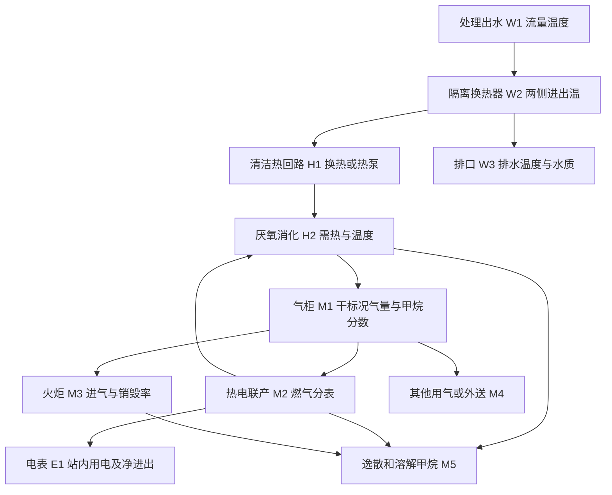

# 迁移研究｜污水站计量与潜在学术交流

**可迁移的是一套能量和反事实的计量方法。** 食品厂侧已控的冷库、清洗班次，在污水处理站须重新定义为相同进水量/负荷、相同出水服务、消化温度、污泥处理能力以及电力服务。在这些条件没有配对证据前，站点的真实新增减排量为 **DATA_NOT_READY**。

## 同一座站有两笔物质账

|账目|计算及反事实|缺了什么就不能下结论|
|---|---|---|
|出水显热与消化供热|洁净侧热量与污水侧 质量流量 × 比热 × 温差分别校核。若采用热泵，供热 = 低温取热 + 压缩机输入，记录两侧品位和辅助电。消化热按需补充，分别列 CHP 可用热、外部备热、终端交付及弃热。|进出流与温度时序、出水温度许可条件、污堵后传热和压降、清洗停机、消化负荷。污水不得跨接洁净工艺水，隔离换热、检查点和低温回落边界随站点确定。|
|原气与甲烷质量|每股流量换算至相同干标况，乘甲烷体积分数与同基准密度得 kg CH₄。气柜期初 + 实收 = CHP 投入 + 火炬投入 + 其他锅炉/提纯外送投入 + 经验证的放空/泄漏 + 期末。未闭合差额列作不确定量。|气量、温压湿基准和组分、库存、火炬运行、发动机甲烷逃逸与火炬未燃尽、提纯尾气、未进入气柜的溶解/无组织甲烷。捕集量、销毁量和净逸散量需分别计量。|
|站内总能量及排放|CHP 燃料按实测热值折算，分别记录上网/自用电与可用供热，计厂用电。甲烷质量仅对未销毁并排入大气的份额应用指明版本/时间窗的 GWP；各源避免重计。分别核对购气、净购电、逸散 CH₄，若申报全站变化另含处理过程 N₂O及边界相关项。|燃料、购电、CHP 分表、排放因子时段及范围、CH₄测量与不确定性。已给消化器供热的 CHP 热不能再次全额售热；把沼气从现有 CHP 转向外售会失去原有电和热。预设反事实若本来就火炬销毁，不能把全部回收气当成避免直接排放。|

澳洲 Malabar 公开报告描述的既有情形为，消化产生沼气，大部供现场热电联产、余量由废气燃烧器处理。这给出了竞争用途和反事实的实例。IPCC 的废水章节覆盖污水、污泥和排放路径；国家清单默认系数不能证明单站某次干预的实绩。[ARENA Malabar 案例](https://arena.gov.au/knowledge-bank/malabar-biomethane-project-proof-of-concept-life-cycle-assessment/) · [IPCC 2019 Refinement，卷 5 第 6 章](https://www.ipcc-nggip.iges.or.jp/public/2019rf/pdf/5_Volume5/19R_V5_6_Ch06_Wastewater.pdf) · [ClimateOS #165 的数据准入边界](https://github.com/simon947161/eco-agent-system/pull/165)

## 给潜在 UNSW 合作者的方法讨论

供未来与莫教授交流时使用；此文仅为独立研究提纲。

1. 怎样把同产量、同品质、同冷库温度和热水准时交付做成可检验的配对条件？ *Which uniform production, quality, cold-chain and timed hot-water constraints would make the comparison credible?*
2. 怎样把天气和班次分开？能否在天气和产量相近的多个班次切换回收策略，预先登记比较时段，同时记录停产、维护、异常清洗和传感器漂移？ *Could matched shifts or a pre-registered crossover distinguish weather and production changes from a change in heat recovery?*
3. 哪些温度、流量、泵电或甲烷逸散观测足以推翻净收益？ *Which metered temperatures, flows, pumping loads or methane losses would overturn the claimed benefit, and how should uncertainty bound it?*

每条记录共用 site_id、asset_id、meter_id、区间起止 UTC 和现场时区、采样间隔 s、单位、数值、测量/厂方记录/模型假设/缺失、来源及使用权、校准日期、不确定度与质量码。停机、缺测与零流量有单独码；保持原时间分辨率和时钟偏差以便配对。下表是最少需要交换的字段组。

|服务或设备|字段与单位|来源与审核|
|---|---|---|
|气候、班次、等服务|室外/进水/原料/库内/末端温度 °C；原料 kg/h、清洗 kg/h、目标/实测温度 °C、生产/清洗起止及事件码；污水 m³/h、COD kg/m³、出水品质、消化器温度 °C|气象站、生产与实验室记录、冷链和热水表；标识湿球/干球、时间窗、停工及样品代表性|
|回收、储热、管段|源/用户/供回温度 °C，流量 m³/h，压差 kPa，泵电及压缩机电 kWh；累计热量 kWhₜₕ、库存/始末 kWhₜₕ、液位 m；地温 °C，单程长度 m|热表、电表、储罐记录和图纸；传感器配对，注明几何、保温/污堵状态和温层假设|
|燃料与净电|燃料热值 MJ/单位、用量、锅炉季节效率、分电表及进出电 kWh；区间电碳 kgCO₂e/kWh，燃料燃烧因子 kgCO₂e/kWh 燃料|供应账单、校准表计和因子版本；区分热值口径、厂内发电/电力外送|
|气柜和逸散|湿/干标况气量 Nm³/h，参考温度 °C、绝压 kPa、甲烷体积分数 %，支路甲烷 kg/h；溶解 CH₄ mg/L、出水流量、实测逸散 kg/h 及误差、火炬/CHP 运行状态与销毁/逃逸率|气柜、气体分析、烟气测试、排口及逸散测量；指定参考态、实测/估算、是否已含下游重叠来源|

**AI 建议记录示例。** 冬季 06:00，当前版本的 100 m 合成路线预计本日减少 8.44 kgCO₂e，同时电峰增加约 0.081 kW。建议值班人员在同等服务及温度、压差、洁净侧隔离均成立时考虑开泵，并展示输入来源、计算版本、反事实与不确定性。若现场压差异常、热水清洗取消或保供容量下降，工程人员可将建议置为“拒绝/待查”，保留时间、原因和覆盖值；恢复前核对换热器与实测服务。实际干预时保存模型预测、人工选择和事后表计，允许结果否证建议。此任务未向任何设备下发命令。
