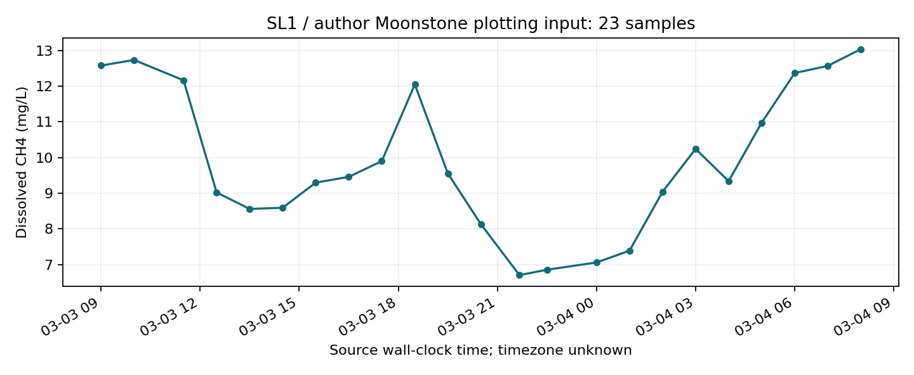

# ClimateOS 本地案例与方法验证双线核查报告

任务：CLIMATEOS-LOCAL-CASE-METHOD-INTAKE-001　执行日期：2026-11-06。

## 本轮实际成果

A线为 WITH_GAPS：选Cooma填埋场为主案例、The Glen污水厂为补充，共2个独立场址。已有官方历史活动及区域资产背景，未取得可用于本地排放验证的气体原始观测。

B线为 RAW_DATA_AUDIT_PASSED_WITH_LIMITS：审查3个新候选，合法取得Zenodo一个研究中的2个原始ZIP，共814,022字节。实际运行只读QC、样本描述统计、绘图输入交叉核对及作者流量汇总复算。D3仍为DATA_NOT_READY，P1-A与科学评审仍为PENDING。

## 一、本地案例究竟掌握了什么

Cooma主场址复用PR136的GA GDA2020点位(149.153052526,-36.248917539)。堆肥与reuse共址，不重复计数。The Glen复用(149.1137999,-36.20030315)。海拔、距海距离、实际气压仍为null，未用机场海拔冒充设施海拔，也未把坐标差异推导成甲烷差异。

EPA2018年Cooma FOGO案例记载：2015年1月服务启动，覆盖3100户；前8个月收集416吨，前12个月463吨；红盖桶有机物减少51.6%。这是服务分流历史，两个累计期重叠，不能相加，也不能当作填埋场残余入场量或甲烷减排量。精确结束日期未明确，保留null。来源A6，第2–3页。网页提取可读，但字节下载403，未宣称取得可哈希PDF，也不再重试。

Council污水资产计划封面为2025–2035、2025年6月19日采纳。印刷第1页/PDF第7页列出的5.0百万升/日和8座处理厂属于区域资产组合，不是The Glen单厂流量。未确认单厂COD/BOD、逐年污水负荷、捕集燃烧记录或甲烷观测。2024/25年报列表标57MB，超过单文件50MB门槛，没有下载。资料未在本轮找到不等于资料一定不存在。

BOM机场站070217的目录索引给出约-36.29、148.97、930m。最新观测栏目是QNH/MSL，不能直接当作P1所需绝对站压。未取得与2015FOGO或本地气体同步的历史小时资料，未伪造时序或计算dP/dt。

## 二、合法数据准入与停止记录

1. CSIRO69356，DOI10.25919/np2s-4061：150文件、55图的填埋场技术经济分析，CC BY-SA4.0；部分基础商业/政府数据保密。只核对公开元数据，没有运行经济或减排成本模型，未认定为现场气象甲烷数据。
2. Zenodo17718964，Jiuling Li《Sewer CH4》v1，2025-11-26，CC BY4.0：许可来自原始页面嵌入记录，两个公开ZIP取得并核对发布者MD5与SHA-256。作者论文Sharma等，Nature Water 4,196–205(2026)，DOI10.1038/s44221-025-00574-w。论文关联SeweX为专有软件，未执行。UQ作者身份不证明SL1现场位于澳大利亚。当前按地点未核实的方法参考单列，不能当作Cooma证据。
3. Water Research X，DOI10.1016/j.wroa.2025.100480：数据声明为可联系索取，主站403。CONTACT_REQUIRED，未联系作者、未换镜像/API、未取得原始数据许可。

Council污染监测入口曾有403，本轮误重复打开了一次已知受限入口，作为执行偏差记录；之后未换入口绕过。其余403也已停止。新候选数3、精读本地官方资料8份、独立本地场址2处，均在范围内。原始ZIP保存在git-ignored runtime_data，不改变原数据或权限。

## 三、真正运行的有限验证

23条作者标注的溶解甲烷浓度记录，原始墙钟2016-03-03 09:00至2016-03-04 08:00，跨度23小时。无空值、无重复甲烷时间戳；时区未给出，未转换UTC。均值9.898099、中位数9.459737、范围6.705469–13.040000 mg/L。均值是样本算术均值，采样不等间隔，不能称日均或时间加权均值。

独立重算公式：样本均值Σcᵢ/n。单位等价：1 mg/L = (10⁻³ g)/(10⁻³ m³) = 1 g/m³；只改变水相浓度表达，不转换成大气ppm、气体密度或通量。逐行原值、单位和因子保存在measured-transcription.csv。

工作簿23对时间/数值与作者Fig2c的Moonstone绘图输入逐项完全一致。这是转录/绘图输入一致性检查，**不是两个独立观测数据集，也不是现场科学验证**。

流量表有1705行、311个不同时间戳、194个时间戳重复，共1394条超出唯一时间戳的行。同一时刻不同值可能是输入编码/事件边界，现有材料不足以解释，未删重、求平均补齐、插值或与甲烷强行连接。作者Summary表均值18.02925980951026 L/s，复算为18.02925980951026 L/s，双精度差约3.6e-15；这只复现逐行算术汇总，不证明真实时间平均。没有计算浓度×流量，更没有把水中输送量叫作大气逸散。

进水表中SCH4与气相CH4g列标mg COD/L，实测表是CH4 mg/L，两者物理定义不同。本轮不将COD当甲烷质量。作者MATLAB还把未中心化误差比标作R²，本轮未执行、未复算该性能指标，也未据此声称模型精度。

曲线仅连接同一来源样本以便阅读；不表示连续观测、时区已知、设施日排放或气压驱动。

## 四、哪些问题仍不能回答

本地入场残余垃圾逐年吨数、组成/龄期、单厂COD/BOD、设施甲烷采样算子、仪器/校准、实际站压、气象时空同步均未形成可用证据链。B2有原始文件可核查，但缺时区、仪器/采样与不确定度、站址映射、独立验证划分和同期气象。本轮未把水相浓度升级为排放通量。

后续最小路线：A保持Cooma主案例，等待合法可用的设施逐年活动/工艺/监测文件和明确权限；B先核实原研究方法与SL1/Moonstone站址、时区、流量重复的含义，再考虑同期气象。需要联系作者、付费、解除受限入口或启动真实设施拟合时另行授权。无需重新建立数据库或智能体平台。

## 五、验证、交付与交接

执行 validate_intake.py 与 test_intake.py。5项测试覆盖原始双哈希、作者绘图输入一致性、流量汇总及重复时间风险、缺时区不转UTC、统计复算/水相单位及科学准入。完整运行日志随包。仅执行本任务测试，未重复运行PR138的全仓522测试，未声称通过。

离线包包含本报告HTML/Markdown、原始许可来源台账CSV/JSON、实际下载收据、设施/活动/对齐台账、逐行转录、QC结果、复算源码和notebook、测试记录。原始文件可按精确URL和收据核对；包不重新分发照片PDF、第三方论文或专有模型。上游原始ZIP不入Git；哈希支持本地原件校验。

PR132、135–138均于本轮在线核对为OPEN Draft，HEAD见baseline-and-gates.json。PR138是合成软件验证，科学评审尚未见ACCEPT。本轮结果提交审阅后也维持PENDING，未部署、未合并，未修改旧PR分支。CarbonOS canonical索引位于PR132独立分支，仅在当前项目索引链接交接，不强行导入。

附件指针未能经Library读取；已完整读取同名正式任务书Library版本及仓库任务书执行，未宣称比对过上传附件的字节。原任务书的TASKBOOK_READY是历史授权快照，最新状态看NEXT_SESSION。

## 来源与证据入口
- [A1](https://www.snowymonaro.nsw.gov.au/Environment-Waste-and-Weeds/Waste-and-Recycling/Environment-Operations-Act-and-Pollution-Monitoring) — BLOCKED_403_STOP。Cooma EPL6194; Jindabyne EPL20060 listed; not independently verified licence originals。限制：Known prior403 was mistakenly opened once again this session. No alternate endpoint or file retry; execution deviation recorded.
- [A2](https://www.snowymonaro.nsw.gov.au/Council/Integrated-Planning-and-Reporting) — TEXT_READ_THEN_403_STOP。2024/25 annual report listed57MB, exceeds50MB per-file gate; wastewater AMP listed8MB。限制：No57MB download; later find returned403; stopped.
- [A3](https://www.snowymonaro.nsw.gov.au/files/assets/public/v/1/council/ipr/20252026/adopted-amp-wastewater-20250619.pdf) — TEXT_READ_THEN_403_STOP。Cover2025-2035; adopted19June2025; printedp1/PDFindex6: regional8WWTP,5.0millionL/day,250km mains,32pumps,4100manholes。限制：Regional portfolio, not TheGlen load. Later text find returned403, stopped.
- [A4](https://www.snowymonaro.nsw.gov.au/News-and-Media/News-articles/Monaro-High-School-students-embark-on-an-exciting-learning-journey-at-The-Glen) — INDEX_ONLY。11Aug2023 Council title associates TheGlen with Cooma wastewater treatment。限制：No process or methane measurement established.
- [A5](https://www.epa.nsw.gov.au/Working-together/Grants/organics-infrastructure-fund/Closed-organics-funding-programs/organics-collections) — TEXT_READ。Links Cooma FOGO case study。限制：Grant index is not an emissions dataset.
- [A6](https://www.epa.nsw.gov.au/sites/default/files/18p0747_snowymonaro-cooma-fogo-case-study.pdf) — WEB_TEXT_READ_BYTE_DOWNLOAD_403_STOP。2018 case: Jan2015 service start;3100households;416t first8months;463t first12months;51.6% red-bin organics reduction。限制：No raw PDF hash claimed. Overlapping periods cannot add. FOGO is not residual landfill tonnage or methane.
- [A7](https://www.bom.gov.au/climate/data/stations/) — TEXT_READ。Some daily/monthly observations free; extraction may incur charges。限制：No paid request made.
- [A8](https://www.bom.gov.au/climate/averages/tables/cw_070217_Info.shtml) — INDEX_METADATA_ONLY。Cooma AirportAWS070217; roundedlat-36.29,lon148.97,height930m。限制：Latest obs IDN60801.94921 lists QNH/MSL; absolute station pressure and historical matched series not established.
- [RIGHTS-EPA](https://www.epa.nsw.gov.au/About-us/Contact-us/Website-service-standards/copyright) — POLICY_READ。EPA-owned materials CC BY4 with exceptions incl third-party content/photos。限制：Older cached noncommercial wording conflicts; current primary body controls. No full photographic PDF redistribution.
- [B1](https://data.csiro.au/collection/csiro:69356) — METADATA_ONLY_PURPOSE_MISMATCH。DOI10.25919/np2s-4061;v1;22Oct2025;150files/55figures;CC BY-SA4.0;landfill techno-economics。限制：Not established methane-weather observations; no confidential-derived economics executed.
- [B2](https://zenodo.org/records/17718964) — RAW_DATA_AUDIT_PASSED_WITH_LIMITS。JiulingLi,SewerCH4,v1,26Nov2025,DOI10.5281/zenodo.17718964;23author-labelled measured dissolved methane samples。限制：Sewer, not landfill/TheGlen. UQ authorship does not prove acquired site geography. Timezone/instrument/weather gaps.
- [B2-PAPER](https://www.nature.com/articles/s44221-025-00574-w) — PAPER_TEXT_READ。Sharma etal,NatureWater4,196-205(2026),published2Feb2026;data linkedZenodo;SeweX proprietary。限制：No proprietary software or upstream MATLAB executed. No model-skill ranking.
- [B3](https://www.sciencedirect.com/science/article/pii/S2589914725001781) — CONTACT_REQUIRED_403_STOP。DOI10.1016/j.wroa.2025.100480; wastewater methane Europe/Australia; data may be provided on request。限制：No contact, mirrors or alternate file/API requests.