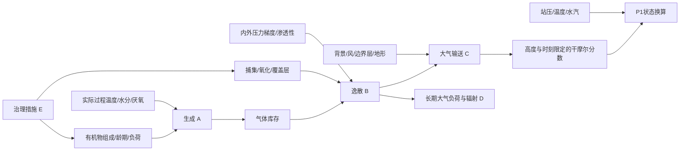

# A–E 科学问题与机制矩阵

本表是待验证机制框架，不是实测因果或统一排名。来源：PR138冻结P1–P4结构、PR139资料限制、[IPCC 2006 Vol5](https://www.ipcc-nggip.iges.or.jp/public/2006gl/vol5.html)第3/6章；不同清单方法不因此失效。

|问题|直接变量与机制方向|代理/混杂/纯标签|可干预性|时间与反馈|必须有的验证证据|
|---|---|---|---|---|---|
|A 生成|底物库存及可降解性→生成；温度、水分、氧化还原条件影响过程速率|气温代替堆体/塘水温仅代理；季节与工艺共同变化|有机物分流、工艺及负荷可干预；天气不可直接控制|负荷到气体可小时至多年，因工艺而异；产热与水分反馈待测|实测过程温度、含水率、组分、龄期、产气和校准；PR138 P4参数HYPOTHETICAL|
|B 逸散|库存变化、捕集、氧化、内外压梯度和渗透性→表面/边界逸散|站压不是全部压差；降雨同时影响覆盖与输送|捕集系统、覆盖与维护可干预|压力可短时释放历史库存；生成与释放并不同步|连续流量、CH4组分、压力、漏点、氧化与质量平衡；P2单向阀仅合成结构|
|C 输送/浓度|源与背景经风、混合层、气团→特定高度浓度；P/T/e影响状态换算|海拔/经纬度是空间标签或代理；地形可作用于输送；仪器、时间、背景筛选混杂|观测设计可调整；区域风不能当设施减排开关|秒至季节；混合层与热环境耦合|同期同尺度气体、风、背景、仪器、高度与误差；无反演授权|
|D 辐射/气候|大气负荷、寿命、辐射机制与时间尺度|局地热环境、局地mg/m³不等于全球强迫；海拔不是吨CH4的法定GWP因子|通过真实减排影响负荷，不由本次站点差推定|多年尺度与化学反馈；本轮不模拟|独立大气/辐射证据及指定核算规范；本轮无结论|
|E 治理/经济|措施→工艺/捕集→经核证的边界排放变化|价格、基线、法规与选择偏差；地区名称本身不是措施依据|运维/投资可选但本轮不实施|建设、运维和寿命期；能源与N₂O权衡|现场基线、对照、成本、许可、MRV及独立审查|

不能把弹性大小当自然界重要性：可观测变化幅度、误差、尺度和研究问题决定可检出的贡献。所有机制箭头需独立数据验证方向、时滞与混杂，不能仅由图证明。
