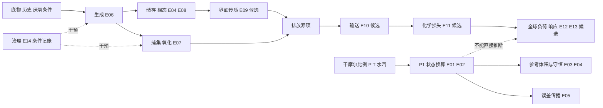

# 原创机制关系图与断链诊断

图为解释路径，不是所有节点均有求解器。机器节点/边在MECHANISM_GRAPH.json；F_是因素，E是方程，防止同名碰撞。DEPENDS_ON用于执行器equation.dependencies定义，图谱MAY_INFLUENCE表示机制上下文而非每个因子都是公式显式参数；CAUSES_WITH_MODEL只在指定FOD假设内。OBSERVED_AS表示观测量进入表示关系，不保证校准；NOT_INFERABLE_FROM箭头从不足的证据指向不能推出的结论。CONFOUNDED_BY关系为“from可能混杂to”（例如背景影响所测摩尔比例），不是已识别因果效应。

断链已实际检查：节点唯一、边端点存在；执行DAG能找到E01→E02、E03→E04以及E02→E05。计算路径排序不等于时间顺序；物理图谱不自动执行。见evidence/graph-diagnostics.json。

主要科学断点：Henry平衡→通量缺k_L/界面；年度FOD→小时P2缺相态/组成/库存边界；排放→气候缺输送/化学/响应准入。即使节点ID均存在，这些物理接口仍未闭合。

反馈：降解放热影响过程温度再影响降解，只记为E06→F_A04→E06的未验证能量耦合假说；没有热容、能量收支或动力学参数，不求解。OH/甲烷寿命、气候/湿地也存在待研究反馈，不能用一次拓扑排序代替动态联立求解。执行DAG一旦成环直接拒绝；未来须新授权、状态方程、初始条件、稳定性和守恒验证。
