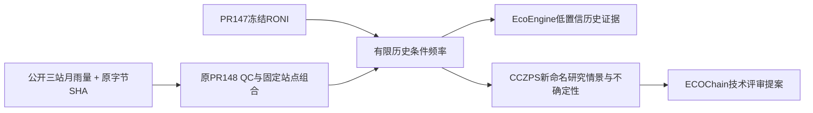

# 回到物理主线：已有能力如何接收本轮证据

只新增一个标准库离线模块和研究数据包；复用PR148质量函数、PR147 RONI/统计/Atlas trace、EcoEngine meteorology_evidence_record、CCZPS已有纯record builder。未新建门户/GIS/数据库/智能体。

真实执行结果见results.json：EcoEngine是历史SON2012描述值（not_recent_weather=true），不可被误作近期气象；CCZPS新情景wagga_enso_research返回requires_spatial_validation、approval_support_status=not_ready_for_approval、evidence_strength=low。其既有四情景完全未修改，旧字段rainfall_signal仍unknown；数值在明确链接的本轮证据中，不虚构完整业务连接器覆盖。ECOChain canonical仍NOT_FOUND，当前只提案记录；Enotebook PENDING_INTEGRATION。

## 三条已有主线的保护

- PR147甲烷全球ERF公式结果0.569344413968403 W/m²及适用边界保留；不得解释为局地设施排放效应。
- PR144合成物料账95/32.7/31.08及真实设施DATA_NOT_READY保留，未做新甲烷实验。
- PR147水文三节点残差0及31条E质量记录阻塞保留；闭合不等于输入实测合格。
- PR146 Atlas、PR145 A/B/C分层技术审查未改；Scorecard澳大利亚2005/2030基准冲突及英文稿NOT_SENT未改。
- PR148旧DATA_NOT_READY是其历史批次的真实结果，保持原文件与HEAD不变；本次成功是新批次，不回写旧历史。

## 物理链下一步（建议，未执行）

海温→Walker环流→区域降雨→水文/生态必须逐段验证。本轮仅对“ENSO指标与局地降雨”给出关联，未测Walker环流，也未证明到径流或生态的因果传递。建议Founder评审后优先选择既有合法水文断面：先确认同地降雨—径流时间/面积/质量可对齐，再预登记一个最小月水量检验，保留储量变化与蒸散缺口；若仍只有E质量数据则停止，先解决质量，不填假流量。环流中介和IOD/SAM属独立后续协议，不在本轮追加取数。

方法比较应保留普通气候学基线；不能预设ClimateOS优于基线。当前统计成功即停止网关扩张，返回有观测支持的一段物理过程问题。
