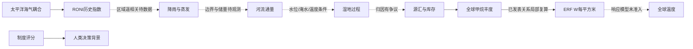

# 跨过程矩阵：机制不是统一系数

行是解释来源，列是被解释过程；每格没有未经验证的数值传递系数。机器对应 [CROSS_RELATIONS.json](CROSS_RELATIONS.json)。

| → | CH4 | ENSO | 流域 |
|---|---|---|---|
| CH4 | KNOWN_MECHANISM：全球丰度→ERF局部复算；CE03 | NOT_IDENTIFIED：长期强迫≠内部变率；CE03/07 | BLOCKED：全球浓度不能换算当地流量；CE03/07 |
| ENSO | CONDITIONAL：湿地/化学可能调制，归因有争议；CE07 | OBSERVED_ASSOCIATION：历史指数季节持续性；CE05/06 | CONDITIONAL：区域降雨/蒸发可影响径流，须区域证据；CE04/11 |
| 流域 | CONDITIONAL：水位/淹水与厌氧环境耦合，幅度待证；CE07 | NOT_IDENTIFIED：没有河流→ENSO已识别模型；CE11 | KNOWN_MECHANISM：守恒成立，真实输入仍缺；CE08/09 |

CH4长期温室强迫由[NOAA AGGI](https://gml.noaa.gov/aggi/aggi.html)支持；[NOAA ENSO](https://www.noaa.gov/understanding-el-nino)描述耦合变率。两者作用时空尺度不同，本包不能识别CH4单独改变ENSO的系数，也不能把某个ENSO事件归因于甲烷。

尼罗河必须用专门证据：[Siam & Eltahir 2015](https://doi.org/10.5194/hess-19-1181-2015)基于20世纪资料，摘要报告ENSO约解释25%年际流量变率，南印度洋区域约28%，联合约44%。这些是**原作者结果、未在本包重算**，有条件子集更高的解释率不应当成普适预测精度。该研究支持多模态条件关系，也反驳“ENSO单因素足够”；旧时期统计不能自动适用于现今调度后的河流。本包只读到摘要，没有导入其模型。

湿地甲烷的[2024反演研究](https://www.nature.com/articles/s41467-024-55266-y)与[2025反证研究](https://www.nature.com/articles/s43247-025-02438-3)在近期热带淹水解释上并不一致。本轮出版方摘录可读、全文身份重定向受阻，保留方向性争议；没有下载原数据来裁决，也没有拼接两篇不同基线的数值。

共同结构可用一个**解释关系图**表达，箭头不代表已识别的因果效应：

动力学解释输送和随时间变化；热力学约束能量；统计学描述条件分布；治理学审查责任与权限。四层不能互换。所有跨过程数值系数为null，不能从图的连通性推出计算可执行。
