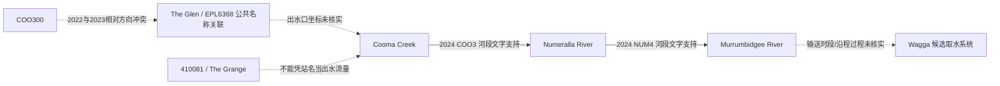

# 拓扑冲突与水文边界

2026-11-24 · READ_ONLY · 完整路线 `TOPOLOGY_UNVERIFIED`

实线只表示**河段名称连接有官方报告支持**，不是经GIS核验的有向几何、常年连通或污染物贡献证明。虚线表示缺证假说。

|待核对象|来源与实际发现|空间/时间/QC缺口|结论|
|---|---|---|---|
|The Glen ↔ EPL6368|[SMRC公开目录](https://www.snowymonaro.nsw.gov.au/Water-and-Wastewater/Wastewater/Environmental-Protection)把两者关联|许可详情页Cache miss；许可当前条件、监测点与出水口不等同|名称关联 METADATA_SUPPORTED；具体排放点 UNKNOWN|
|STP → Cooma Creek|[2024报告](https://www.act.waterwatch.org.au/__data/assets/pdf_file/0006/2827986/Reach_report_cards_2024.pdf) p21描述STP排入COO3河段中部|报告未在已读文字中绑定正式设施ID、出水口坐标/CRS/测绘日期|河段级支持；The Glen 精确出水口仍TOPOLOGY_UNVERIFIED|
|Cooma → Numeralla|同报告p21的COO3终点|河段GIS线/方向、具体汇流点、短路/溢流支路未取原件|NARRATIVE_SUPPORTED，不是GEOMETRY_VERIFIED|
|Numeralla → Murrumbidgee|同报告p28 NUM4范围；[2025报告](https://www.act.waterwatch.org.au/__data/assets/pdf_file/0006/3039162/2025CHIP-Report_ScreenReady5.pdf) p18–19叙述|未验证有向河网/坝闸/当时流态|NARRATIVE_SUPPORTED|
|COO300 vs 出水口|[2022](https://www.act.waterwatch.org.au/__data/assets/pdf_file/0006/2196051/catchment-health-indicator-program-report-2022.pdf)官方索引描述STP在COO300下游；[2023](https://www.act.waterwatch.org.au/__data/assets/pdf_file/0007/2418352/CHIP-2023_FINAL.pdf)描述在其上游|两份PDF超过工具大小限制；后续文字未消除矛盾；可能是文本错误、站点变化或参照不同，但这些都只是候选解释|CONFLICT_OPEN；禁止作为上下游对照标签|
|2024/2025复核|2024 p21只述河段中部；2025综合报告p18–24述区域/干旱|2025独立reach报告虽在目录列出，本轮未取得可验证具体页；2024截图工具返回无可用图像、另一页Cache miss|没有声称地图目视核验或2025已纠正旧错|
|410081|[Numeralla West官方报告卡](https://www.water.dcceew.nsw.gov.au/sites/default/files/2025-08/Numeralla%20West%20Water%20Source%20Report%20Card%20%28PDF%2C%201408.66%20KB%29.pdf)索引命名 Cooma Creek at Cooma No.2 (The Grange)|坐标/CRS、运行期、评级曲线、时区、系列QC UNKNOWN；全文Cache miss|IDENTITY_METADATA_ONLY；不是effluent flow|
|Wagga取水|[Riverina Water](https://rwcc.nsw.gov.au/your-water/water-supply/yourwater/)公开说明Murrumbidgee地表水和地下水来源|取水混合比例、路径、行程、处理/储水、污染源指纹均未验证|候选暴露路径；不得说有可测Cooma贡献|

2024 p21记述溪流到年底干成水潭；2025 p20也报告Cooma等溪流后期断流。它们是年度报告叙述，**没有原始日流量或精确断流区间**。不把 L14 的取水规则阈值当观测值；不把报告中“nitrate mg/L”自动视作NO3-N。

下一步若获批准，优先需要权威出水口坐标/CRS/有效日期、COO300站点沿革和有向河网/同期连通证据。原有PR129 Geofabric CRS约定不是本轮坐标证明；旧ArcGIS499端点未重试。本站点排序子任务在此STOP，其余元数据工作可独立完成。
