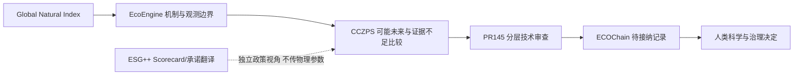

# 返回科学与治理主线的接口

实际代码：`cczps_lite/integration/global_natural_systems_atlas.py` 的 `end_to_end()`。返回自然过程证据ID、独立政策对象、既有CCZPS四场景状态、PR145 A/B/C原结果及额外语义标签。**这是一条可复现的接口演练，尚不是端到端环境预测/减排应用。**

| 层 | 实际执行 | 没有假称完成的内容 |
|---|---|---|
| 自然索引 | 以Australia关联CH4_SOURCE查询过程与来源 | 未把AU全境当同质甲烷源 |
| EcoEngine证据 | 引用PR143知识/边界，连到全球库/辐射缺口 | 不新增源率、OH、GWP高度修正或响应核 |
| CCZPS | 调用原 `build_scenario_comparison`，显式空证据避免环境中旧输出被误用 | 四场景insufficient_evidence_for_comparison；Batlow仅配置背景，未实现甲烷干预场景 |
| ESG++ | 以政策对象展示AU原站50及基年冲突 | `policy_sent_to_model=false`；没有传入数值参数 |
| 技术审查 | 原PR145 A方法对齐、B矛盾、C证据不足 | B仍可能算术RECALCULATED，但统一标INTERNAL_FIXTURE_REPLAY_ONLY |
| 人类/长期记录 | 返回PENDING与正式迁移待办 | 不是注册审批者；没有独立机构签名、外部信任锚或法定认证 |

ECOChain状态仍 **ECOCHAIN_CANONICAL_NOT_FOUND**；Enotebook仍 **PENDING_INTEGRATION**。旧审计在PR145同名文件；本轮没有新正式授权接纳回执，不修改已有schema或冻结记录。研究来源和结果可供审核，不能自行变成EFFECT_VERIFIED。

## NEXT_DECISION：从“有方向的知识”走向“同边界证据”

建议Founder在ChatGPT审查后，只批准一项窄的后续科学连接：**给既有PR144四接口账/PR145 typed claim制作一个合法开放、同设施、同时间窗的测量包准入协议**，至少需要流量、CH₄组分、温压干湿基准、设备状态、边界库存/旁流、校准及不确定性。候选限1个；拿不到就DATA_NOT_READY，不再扩展全球来源或执行模型。现有BRW点浓度、Scorecard与23SL1溶解浓度均不能替代该包。

为什么：三路径揭示真正断点在观测→输入可信→边界闭合，而非更多国家、地图或分数。它直接连接EcoEngine物理接口、CCZPS不确定性比较和PR145逐层审查；不需要新平台。

并行治理决定仅限确认：谁拥有ECOChain权威目录、谁可独立技术评审、如何登记利益冲突与外部签名/撤回。Founder应指定实际角色和接纳地点，不能由本原型自授身份。未批准前只保留迁移映射，不创建生产审批系统。

继续保留：D3 DATA_NOT_READY；P1-A PENDING；PR140 NO_VALID_PAIR；PR141 NO_VALID_VERTICAL_PROFILE；PR143 ChainB BLOCKED；PR144真实场址DATA_NOT_READY；Stage3 METHOD_READY_NOT_VALIDATED。新的Atlas软件通过不会改变这些状态。
