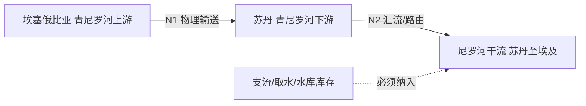
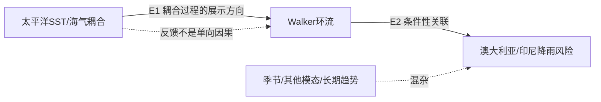
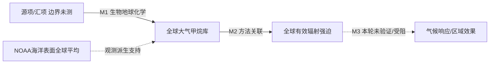

# 三条跨边界机制：解释、反证与可计算性

下列式子是守恒/研究设计说明，不是本轮已运行的水文、气候或排放模型。图边来源、假设、反证、尺度与状态见 [RELATION_GRAPH](RELATION_GRAPH.json)。

## 1｜青尼罗河上游 → 苏丹 → 干流下游

[NBI监测站原表](https://nilebasin.org/hydromet/map)的Eldeim、Khartoum、Halfaya Bridge、Dongola行支持方向和跨境监测用途。流域成员、主河道经过、NBI成员、法律分水权利是不同概念；不能按国籍切断自然过程。

概念控制体：`ΔS = ∫(Qin + Qlateral − Qout − Qabstraction − E)dt`；若Q以m³/s、dt以s，则库存为m³。降雨若以mm需经明确面积转换，不能直接加到流量。传播时滞、水库调度、回归水与支流不能遗漏。**没有流量/调度/库容时间序列，不能算下游影响**。

可证伪对象是具体边界、方向或定量闭合主张：若实测路由不支持所选河段，需修图；上下游瞬时不等流并不反驳守恒，应先查库存、旁支和时间对齐。可运行的是方向检索，非水量分配和责任认定。

## 2｜热带太平洋耦合 → 环流 → 区域降雨概率

[NOAA原文](https://www.noaa.gov/understanding-el-nino)明确区域遥相关可能但不必然；海温异常需要大气耦合，事件间模式不同。2026-02-01开始采用RONI的说明已在官方页出现，后续若比较旧ONI与新RONI必须固定指标版本，不能拼接为同一序列。

未来可检验的形式是 `P(Y | ENSO状态, 季节, 地区, 其他模态)`，不是 `ENSO⇒本地必旱`。Y的定义、基准期、独立留出事件、阈值和时间窗均须预注册；本轮未拟合概率或计算效应。

反证：一次厄尔尼诺期间某地湿润足以否定“必旱”断言，却不能单独推翻条件概率关系。尚缺合法版本化指数与同窗口区域观测，以及独立对照。降雨也不是甲烷排放的直接替代变量。

## 3｜甲烷源 → 大气负荷 → 辐射 → 响应缺口

复用PR143物理知识与PR144物料账。`dB/dt = ΣE − ΣL` 仅表达全球CH₄质量库存收支，B为kgCH₄、E/L为kgCH₄/s；局部空气摩尔分数不能代入E。全球混合不意味着瞬间处处均匀，更不意味着按上风向分配长期责任。

[NOAA GML](https://gml.noaa.gov/ccgg/trends_ch4/)是海洋表面站点生成的全球均值，当前年还会校准更新。本轮仅挂接产品说明和旧BRW观测，不下载新序列或反演排放。[AGGI 2025方法](https://gml.noaa.gov/aggi/aggi.html)把全球丰度映射到有效辐射强迫，区别直接强迫与快速调整；不能把W/m²当作局部°C。其方法不包括慢速地表温度反馈，公式版本变化影响历史序列。

响应概念可写成 `ΔT(t)=∫K(t−s)ΔF(s)ds`；若时间为s，K单位需为K/(W·m⁻²·s)。本轮没有接纳K、区域降尺度或独立响应观测，**不运行此式**。IPCC AR6 Chapter6本轮403后停止；不伪称全文复读。

反证与识别：浓度变化可来自输送或汇变化；同质量释放高度的气候效应不能靠自定GWP修正。归因要求来源/汇/混合/时间边界、外部独立验证与误差。M3的HYPOTHESIS_ONLY是本轮接口未验证，不是否认成熟温室物理。
